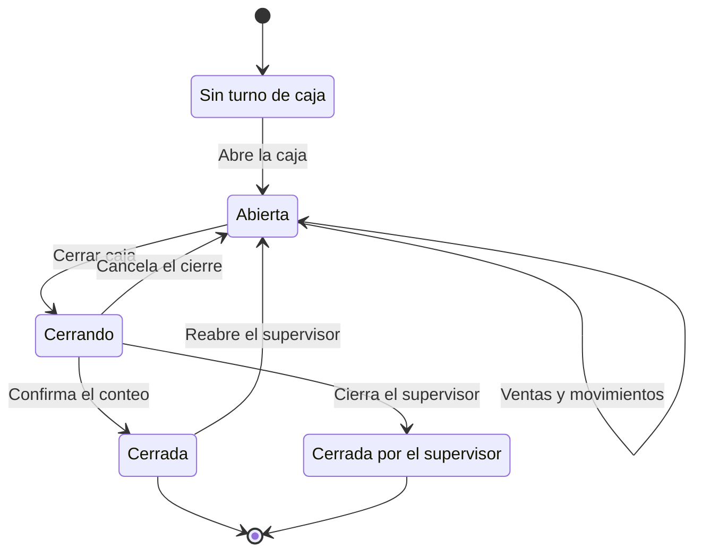

# 02 · Caja

Volver al [índice](00-indice-roles-y-decisiones.md).

## Estados de una turno de caja

**Qué significa:** nadie vende sin una sesión `abierta`. Cerrar exige contar. Un cierre hecho por otra persona queda marcado como forzado. Reabrir es excepcional (DEC-21, DEC-32).

---

## B1 · Apertura de caja

**Rol:** CAJ
**Precondiciones:** sesión iniciada, la sede cumple los mínimos (A3), la persona no tiene otra sesión abierta.

**Flujo principal**

| # | La persona | El sistema |
|---|---|---|
| 1 | Entra al punto de venta | Detecta que no hay sesión y muestra **Abrir caja** (el punto de venta queda detrás, deshabilitado) |
| 2 | Elige la **caja** | Lista las cajas activas. Las ocupadas aparecen deshabilitadas: "En uso por Valeria desde 08:02" |
| 3 | Revisa el **turno** | Sugiere el que corresponde a la hora actual. Se puede cambiar |
| 4 | Escribe el **monto de apertura** (dinero para vuelto) | Teclado numérico grande. Opcional: **Contar billetes** por denominación |
| 5 | Pulsa **Abrir caja** | Crea la sesión. Resumen: "Caja 01 · Turno mañana · Dinero para vuelto S/ 100.00" y entra al punto de venta |

**Excepciones**

| # | Situación | Qué ve y qué puede hacer | Resultado |
|---|---|---|---|
| E1 | La caja ya la tiene otra persona | Opción deshabilitada con el nombre. Sugiere otra caja o avisar a SUP | No abre |
| E2 | La persona ya tiene una sesión abierta en otro equipo | "Ya tienes la caja 02 abierta. [Continuar allí] [Cerrar esa sesión]" | Una sesión por persona |
| E3 | Queda una sesión abierta de un día anterior | Pasa a B5 antes de abrir | Se regulariza |
| E4 | No hay cajas activas | "No hay cajas disponibles. Avisa a tu administrador" | No abre |
| E5 | No existe un turno para esta hora | Deja elegir turno con aviso "Fuera del horario del turno" | Abre con aviso |
| E6 | Monto en 0 | Confirmación "¿Abrir sin dinero para vuelto?" | Abre o corrige |
| E7 | Monto vacío, negativo o con letras | Error junto al campo | No avanza |
| E8 | Monto muy alto frente a lo habitual | "¿Seguro que el dinero para vuelto es S/ 5,000?" | Confirma |
| E9 | El fondo difiere de lo que dejó el turno anterior | "El turno anterior dejó S/ 150 y abres con S/ 100". Pide observación | Queda registrado |
| E10 | La caja no tiene serie de boleta asignada | Bloquea la apertura con el motivo y enlace a ADM. Se detecta aquí, no en la primera venta | No abre |
| E11 | Doble clic en **Abrir caja** | Un solo registro (REG-11) | Sin duplicado |
| E12 | Sin conexión | "Necesitas conexión para abrir la caja" | No abre |

**Casos extraños**

- **X1 · Abrir antes de la hora de inicio del turno:** se permite con aviso suave.
- **X2 · Domingo o feriado:** sin restricción, solo se muestra el nombre del día.
- **X3 · Dos personas quieren abrir la misma caja:** gana quien confirma primero. A la segunda se le informa "Acaba de abrirla Valeria".
- **X4 · La persona abre y se arrepiente al instante:** puede **cancelar apertura** si no hubo ventas ni movimientos (queda marcado como cancelado por SUP).

**Resultado:** sesión abierta, dinero para vuelto registrado, punto de venta habilitado.

---

## B2 · Movimiento extra (ingreso o egreso)

**Rol:** CAJ (hasta S/ 50 propuesta), SUP
**Ejemplos:** pago de agua o limpieza, compra de bolsas, retiro a caja fuerte, aporte de cambio.

**Flujo principal**

| # | La persona | El sistema |
|---|---|---|
| 1 | Menú de caja → **Movimiento** | Dos botones grandes: **Ingreso** y **Egreso** |
| 2 | Elige uno | Lista las categorías de ese tipo |
| 3 | Elige la categoría, escribe el **monto** | Muestra "Efectivo disponible: S/ X" |
| 4 | Escribe la **descripción** (obligatoria) | Contador de caracteres |
| 5 | **Guardar** (con clave del supervisor si supera el límite) | Registra. Ofrece **imprimir vale** y lo muestra en la lista del turno |

**Excepciones**

| # | Situación | Resultado |
|---|---|---|
| E1 | Egreso mayor al efectivo disponible | Bloqueado: "Solo hay S/ 80 en caja" |
| E2 | Categoría desactivada | No aparece. Si falta una, enlace "Pedir nueva categoría" |
| E3 | Descripción vacía | Error junto al campo |
| E4 | Monto 0 o negativo | Error junto al campo |
| E5 | Mismo monto y categoría en el último minuto | "¿Ya lo registraste? Hace 1 min" |
| E6 | Monto sobre el límite del rol | Solicita clave del supervisor |
| E7 | Caja ya cerrada | "El turno está cerrado. Pide a SUP que lo reabra" |

**Casos extraños**

- **X1 · Pago al courier de un pedido:** no hay enlace automático. Se pide poner el número de pedido en la descripción.
- **X2 · Préstamo entre cajas:** no hay traslado. Se hace un egreso en una caja y un ingreso en la otra, con descripción cruzada.
- **X3 · Efectivo en caja muy alto:** sugerencia "Hay S/ 1,800 en caja. [Registrar retiro a caja fuerte]" (umbral propuesto).
- **X4 · Movimiento equivocado:** no se edita. Ver B6.

---

## B3 · Conteo y cierre de caja

**Rol:** CAJ (su caja), SUP (cualquiera)

**Flujo principal**

| # | La persona | El sistema |
|---|---|---|
| 1 | Menú de caja → **Cerrar caja** | Revisa pendientes (ver abajo) y muestra una lista. No bloquea salvo ventas en espera |
| 2 | Revisa el **resumen del turno** | Ventas por grupo de medio de pago, movimientos extra, número de comprobantes. **El efectivo esperado no se muestra** si el conteo del dinero es ciego (propuesta) |
| 3 | **Cuenta el efectivo** por billetes y monedas | Suma en vivo. Pide confirmar "Contaste S/ 1,250.00. ¿Es correcto?" |
| 4 | **Confirmar conteo** | Calcula: apertura + ventas en efectivo (neto de vuelto) + ingresos − egresos − devoluciones en efectivo |
| 5 | Ve la **diferencia** | "Cuadra" · "Sobran S/ 3.00" · "Faltan S/ 12.50" |
| 6 | Si la diferencia pasa la diferencia permitida (propuesta S/ 1.00), escribe la **observación** | Obligatoria. Pide clave del supervisor si es mayor a S/ 20 (propuesta) |
| 7 | (Opcional) **Retirar efectivo** a caja fuerte | Genera un egreso y deja el dinero para vuelto del siguiente turno |
| 8 | **Cerrar** | Estado cerrada. Muestra el **reporte de cierre** imprimible. Cierra sesión o vuelve al inicio |

**Pendientes que se revisan en el paso 1**

| Pendiente | Qué pasa |
|---|---|
| Ventas en espera | **Bloquea**: deben cancelarse o cobrarse |
| Comprobantes sin enviar a SUNAT | Aviso y enlace a la bandeja (H2). No bloquea |
| Pedidos contra entrega sin rendir | Aviso: "2 pedidos con efectivo por rendir" (J8) |
| Movimientos sin descripción | No debería haber, aviso defensivo |

**Excepciones**

| # | Situación | Resultado |
|---|---|---|
| E1 | El conteo coincide | Mensaje breve "Caja cuadrada" |
| E2 | Diferencia mayor a la diferencia permitida | Observación obligatoria |
| E3 | Diferencia muy grande | clave del supervisor y aviso en el resumen del día |
| E4 | Error de digitación evidente (por ejemplo 12,500 en vez de 1,250) | Confirmación del total antes de seguir |
| E5 | Sin ventas en el turno | Permite cerrar con "Turno sin ventas. ¿Cerrar?" |
| E6 | Se cae la conexión al cerrar | Guarda el conteo en el dispositivo. "El cierre se completará al volver la conexión". No se marca cerrado hasta confirmar |
| E7 | Intento de cerrar con ventas en espera | Bloqueado con la lista |
| E8 | Cierre hecho por SUP porque la persona no está | Estado cerrada por el supervisor. Pide conteo y observación. Avisa a la persona al volver |
| E9 | Cierre fuera del horario del turno | Sin bloqueo. Aviso suave |
| E10 | Doble clic en **Cerrar** | Un solo cierre |

**Casos extraños**

- **X1 · Sobrante y faltante que se compensan:** el sistema muestra la diferencia neta y detalla los movimientos para ayudar a ubicar la causa.
- **X2 · Billete falso detectado al contar:** se registra como egreso con categoría "Billete falso" (si existe) y observación.
- **X3 · Efectivo en dólares:** no está soportado. Aviso al intentar registrar una moneda distinta.
- **X4 · Cliente pidió vuelto por Yape:** no existe como pago. Solución guiada: cobrar en pago mixto por el monto exacto o devolver como egreso con observación. Queda como pregunta abierta (archivo 07).
- **X5 · Pagos digitales que no cuadran con la app del banco:** el reporte de cierre muestra un resumen por medio digital para comparar. No hay conteo (DEC-22).

**Resultado:** sesión cerrada con esperado, real y diferencia; reporte impreso o PDF.

---

## B4 · Relevo de turno (entregar caja)

**Rol:** CAJ saliente y CAJ entrante

El relevo se hace en **una sola pantalla** que encadena cierre y apertura, sin que se vuelva a contar dos veces.

| # | Quién | Qué ocurre |
|---|---|---|
| 1 | Saliente | **Entregar caja a…** y elige a la persona entrante |
| 2 | Saliente | Hace el conteo (B3 pasos 3 a 5) |
| 3 | Entrante | Inicia sesión y revisa el conteo mostrado |
| 4 | Entrante | **Acepto el dinero para vuelto de S/ X** (campo prellenado con el conteo, editable con observación) |
| 5 | Sistema | Cierra la sesión del saliente y abre la del entrante con ese fondo |

**Excepciones**

| # | Situación | Resultado |
|---|---|---|
| E1 | La persona entrante no está o no inicia sesión | El relevo queda pendiente. Se sigue en B3 normal |
| E2 | La persona entrante no está de acuerdo con el conteo | **Recontar** con SUP presente. Si persiste, observación y firma de ambos |
| E3 | Saliente se va sin avisar | SUP hace B3 con cierre hecho por el supervisor y abre a la entrante |
| E4 | Ventas en espera del saliente | Deben resolverse antes (B3 E7) |

**X1 · Relevo sin cierre ("seguimos con la misma caja"):** no se soporta, por la regla de una persona por sesión. Se explica en la pantalla.

---

## B5 · Caja olvidada del día anterior

**Rol:** CAJ, SUP

| # | Situación | Qué ve la persona |
|---|---|---|
| 1 | Entra y su sesión sigue abierta desde ayer | Pantalla bloqueante: "Tienes la Caja 01 abierta desde ayer 18:00. Hay que cerrarla antes de vender" |
| 2 | Pulsa **Cerrar ahora** | Entra a B3 en modo **cierre tardío**: conteo del efectivo actual, observación obligatoria y clave del supervisor |
| 3 | Confirma | Se cierra marcando la fecha real de cierre. Luego abre la caja de hoy (B1) |

**Excepciones**

| # | Situación | Resultado |
|---|---|---|
| E1 | La sesión abierta es de otra persona | Solo SUP puede forzar el cierre |
| E2 | Hubo ventas después de la medianoche | Siguen perteneciendo a esa sesión. El reporte lo aclara |
| E3 | El efectivo actual ya se mezcló con el de hoy | Observación guiada: "Explica qué pasó". La diferencia queda en el reporte |

---

## B6 · Correcciones de caja

**Rol:** SUP

| Corrección | Cómo se hace |
|---|---|
| Movimiento extra equivocado | **Anular con movimiento contrario**: se crea uno contrario con motivo y se enlaza al original. No se edita (DEC-31) |
| Error en el dinero de apertura | Movimiento de ajuste con la categoría "Ajuste de apertura" y observación |
| Cerrar por error | **Reabrir caja**: solo SUP o ADM, con motivo, el mismo día y mientras la caja no tenga otra sesión abierta |

**Excepciones**

| # | Situación | Resultado |
|---|---|---|
| E1 | Se intenta reabrir y la caja ya tiene otra sesión | Bloqueado, con el nombre de quien la usa |
| E2 | Reabrir una sesión de días anteriores | Bloqueado. Corrección solo con movimiento de ajuste en la sesión actual |
| E3 | Movimiento contrario que dejaría el efectivo negativo | Bloqueado con explicación |

---

## B7 · Resumen de caja en vivo

**Rol:** CAJ (la suya), SUP (todas las de la sede)

Panel visible desde el punto de venta con estos bloques:

| Bloque | Contenido | Nota |
|---|---|---|
| Sesión | Caja, turno, hora de apertura, quién | — |
| Ventas | Cantidad y total, por grupo de medio de pago | — |
| Efectivo | Esperado en caja | **Oculto para CAJ** si el conteo del dinero es ciego. Visible para SUP |
| Movimientos | Ingresos y egresos del turno | — |
| Pendientes | Comprobantes sin enviar, ventas en espera | Con enlace |

**Excepciones:** sin ventas aún ("Todavía no hay ventas en este turno. [Ir al punto de venta]"), sin conexión (muestra la última lectura con la hora), sesión de otra persona (SUP puede abrirla en solo lectura).
