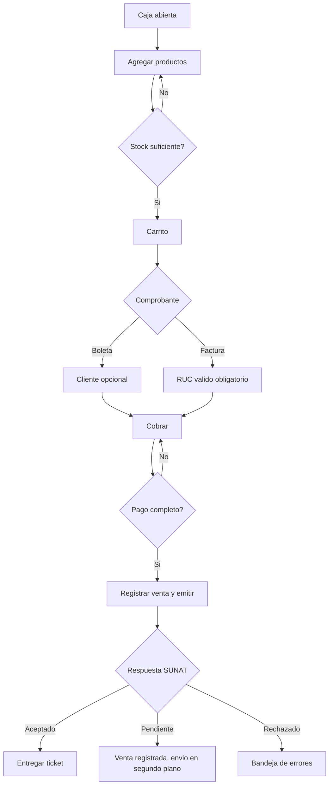

# 04 · Clientes y ventas

Volver al [índice](00-indice-roles-y-decisiones.md).

---

# Parte 1 · Clientes

## F1 · Buscar un cliente

**Rol:** todos
Un solo buscador (en Clientes y en el cobro) que acepta **documento, nombre o teléfono**. Muestra hasta 8 resultados con nombre, documento y última compra.

**Excepciones:** sin resultados ("No encontramos a nadie. [Registrar cliente]" con el texto buscado ya cargado); varias personas con el mismo nombre (se diferencian por documento y teléfono); búsqueda con solo 1 o 2 letras (pide al menos 3).

## F2 · Registrar un cliente

**Rol:** CAJ (rápido), SUP, ADM

**Flujo principal**

| # | La persona | El sistema |
|---|---|---|
| 1 | **Nuevo cliente** (desde Clientes o desde el cobro) | Formulario corto |
| 2 | Elige el **tipo de documento** | DNI, RUC, Carnet de extranjería, Pasaporte, Sin documento (el modelo guarda un código de un carácter; la pantalla muestra nombres) |
| 3 | Escribe el **número** | Valida largo y formato (DNI 8, RUC 11) |
| 4 | Pulsa **Validar** | Consulta RENIEC o SUNAT y completa nombre y dirección |
| 5 | Agrega **teléfono** y **correo** (opcionales) | Validación de formato. El teléfono con 9 dígitos es el que sirve para WhatsApp |
| 6 | **Guardar** | Queda disponible de inmediato en la venta en curso |

En el cobro existe el **registro rápido**: documento, nombre y teléfono, nada más.

**Excepciones**

| # | Situación | Resultado |
|---|---|---|
| E1 | El documento ya existe | Muestra la ficha existente: "Ya está registrado. [Usar este cliente]" |
| E2 | Existe pero pertenece a otra sede (el documento es único en todo el sistema) | "Este documento ya está registrado en otra sede. [Usar este cliente]" (DEC-02) |
| E3 | El servicio de validación no responde | Permite completar a mano con la marca **Sin validar** y la opción de validar luego |
| E4 | El documento no se encuentra | "No se encontró. Revisa el número o completa el nombre a mano" |
| E5 | RUC dado de baja o no habido | Aviso fuerte, y se desaconseja la factura (G4) |
| E6 | Correo o teléfono con formato incorrecto | Error junto al campo |
| E7 | Documento con ceros a la izquierda | Se conserva como texto |
| E8 | Cliente extranjero sin DNI | Permite Carnet o Pasaporte |
| E9 | Nombre escrito en minúsculas o con espacios | Se normaliza |

**X1 · Cliente que no quiere dar datos:** se usa **Clientes varios** (F6). **X2 · Cliente que pide factura a una empresa que no es suya:** no hay forma de comprobarlo; el sistema solo valida que el RUC exista.

## F3 · Editar un cliente

**Rol:** SUP, ADM
Regla: si el cliente tiene comprobantes, **documento y nombre quedan bloqueados** para no alterar reimpresiones (DEC-28). Teléfono, correo y dirección sí se editan. Si hay un error de documento, el camino es una nota de crédito y un cliente nuevo.

## F4 · Duplicados

Si dos fichas parecen la misma persona (nombre muy parecido y teléfono igual), se muestra una alerta "Posible duplicado" con **Revisar**. No se fusiona nada automáticamente. Fusionar clientes con historial lo hace solo ADM.

## F5 · Historial del cliente

**Rol:** CAJ, SUP, ADM
Ficha con: total comprado, número de compras, última compra, tallas y colores más frecuentes (derivado), lista de ventas con estado y enlace al comprobante. Botón **Repetir compra** carga en el carrito las mismas prendas disponibles.
**Excepciones:** cliente sin compras ("Aún no ha comprado. [Nueva venta]"); prendas del historial ya agotadas (se marcan y no se cargan).

## F6 · "Clientes varios"

Registro fijo, no editable ni eliminable (DEC-02). Aparece como opción por defecto en las boletas. No se puede usar en facturas. Si la boleta supera el monto que exige identificar al comprador, el sistema pide un documento (G4).

---

# Parte 2 · Ventas

**Meta de experiencia (propuesta):** una venta de 2 prendas en menos de 30 segundos y con 6 interacciones o menos desde el último producto hasta el ticket.

## G1 · Venta rápida en mostrador

**Rol:** CAJ
**Precondiciones:** turno de caja abierta, la caja tiene serie, hay al menos un medio de pago activo.

**Flujo principal**

| # | La persona | El sistema |
|---|---|---|
| 1 | Entra al punto de venta | El cursor ya está en el buscador (REG-09) |
| 2 | Agrega las prendas (G2) | El carrito se actualiza al instante |
| 3 | Revisa el carrito (G3) | Total siempre visible |
| 4 | (Opcional) elige cliente o tipo de comprobante (G4) | Por defecto: Boleta y Clientes varios |
| 5 | (Opcional) aplica descuento | Límites según el rol |
| 6 | Pulsa **Cobrar** (F9) | Abre el cobro (G5) |
| 7 | Elige el medio de pago y confirma | Revalida stock y precios (REG-16) |
| 8 | — | En una sola operación: reserva el número, registra venta, líneas y pagos, descuenta stock, anota el historial de movimientos, crea el comprobante y lo envía |
| 9 | Ve el resultado (G6) | Aceptado, pendiente o error |
| 10 | **Nueva venta** | Vuelve al buscador, vacío |

La operación del paso 8 es **todo o nada**: si algo falla, no queda una venta a medias.

**Excepciones globales (el detalle está en cada flujo)**

| # | Situación | Dónde se resuelve |
|---|---|---|
| E1 | No hay caja abierta | El punto de venta no deja vender y lleva a B1 |
| E2 | La turno de caja ya no está abierta | El punto de venta se bloquea con el motivo. Si había un carrito, queda en espera |
| E3 | El turno terminó pero la caja sigue abierta | Aviso suave en el encabezado, no bloquea |
| E4 | El stock cambió | G2 E3 |
| E5 | El precio cambió | G3 E5 |
| E6 | Pago incompleto | G5 |
| E7 | Falla al registrar o emitir | G6, G8, H |
| E8 | No se puede imprimir | G6 E4 |
| E9 | Se va la luz o se cierra el navegador | REG-02: el carrito se recupera. Una venta ya confirmada se consulta en el historial |

## G2 · Agregar productos

**Rol:** CAJ

**Cuatro caminos**

| Camino | Cómo funciona |
|---|---|
| **Escáner** | Lee el código de la talla y color y termina con Enter: agrega esa talla y color directo |
| **Búsqueda** | Por nombre, código o categoría. Resultados con foto o bloque de color |
| **Grilla** | Categorías y tarjetas |
| **Packs** | Pestaña propia, con disponibilidad |

**Tallas y colores:** si el producto tiene una sola talla y color se agrega directo. Si tiene varias, se abre el **selector en tabla de tallas y colores** talla × color con el **stock por celda**. Las celdas en 0 aparecen deshabilitadas con "Agotado".

**Excepciones**

| # | Situación | Qué ve y qué puede hacer | Resultado |
|---|---|---|---|
| E1 | Código desconocido | "No existe el código 7751…. ¿Buscar por nombre?" | No agrega |
| E2 | Producto desactivado | "Este producto está desactivado" | No agrega |
| E3 | Cantidad pedida mayor al stock | "Solo quedan 2 en talla M". Se agrega lo disponible | Límite visible |
| E4 | Talla y color agotada | "Agotado en esta sede". Botón **Ver otras sedes** (solo informativo) | No agrega |
| E5 | El sistema dice 0 pero la prenda está físicamente | **Vender sin stock** con clave del supervisor y motivo. Queda marcado para regularizar con un ajuste | Autorizado |
| E6 | Precio en 0 | "Precio no configurado. Avisa a tu supervisor" | No agrega |
| E7 | Talla y color sin stock habilitado en la sede | "No habilitado aquí" | No agrega |
| E8 | Escaneo repetido rápido | Suma de a uno con un sonido corto. Si llega al límite, avisa | Controlado |

**Casos extraños**

- **X1 · Etiqueta ilegible:** escribir el código a mano en el buscador.
- **X2 · Prenda sin etiqueta:** buscar por nombre, con foto si existe.
- **X3 · Dos prendas idénticas con una sola etiqueta:** el escáner lee dos veces o se usa el botón + del carrito.
- **X4 · El escáner no manda Enter:** el buscador acepta además un botón **Agregar** junto al campo.
- **X5 · Pack con un componente agotado:** aparece no disponible (C8 E1).

## G3 · Carrito, descuentos y packs

**Rol:** CAJ

**Líneas**

| Acción | Regla |
|---|---|
| Cambiar cantidad (+ y −) | No supera el stock. Botones de 44 px o más |
| Quitar una prenda | **Deshacer** durante 6 segundos (REG-01) |
| Vaciar | Pide confirmación |
| Cambiar el precio de una línea | Solo SUP con clave y motivo (DEC-10) |

**Descuento:** global, en porcentaje con botones rápidos y campo libre según el rol (sección 1 del índice).

**Orden de totales:** Subtotal → Descuento → **Total a cobrar**, y debajo "incluye Op. Gravada" e "incluye IGV" (DEC-03).

**Packs:** se muestran como un **grupo** que se puede expandir para ver sus componentes. La cantidad del pack se cambia como una sola línea. No se puede quitar un componente suelto.

**Excepciones**

| # | Situación | Resultado |
|---|---|---|
| E1 | Descuento por encima del límite del rol | Pide clave del supervisor o administrador |
| E2 | Descuento del 100 % | Bloqueado. Una cortesía se registra con motivo por SUP |
| E3 | El carrito cambia después de aplicar el descuento | Se recalcula y avisa "El descuento se recalculó" |
| E4 | Descuento más pack | No se acumulan: el descuento se aplica solo a las líneas que no son pack. Se explica en pantalla (pregunta abierta, archivo 07) |
| E5 | El precio de una prenda cambió mientras estaba en el carrito | Al cobrar: "El precio de Blusa Lino cambió de S/ 79 a S/ 69. [Actualizar] [Cancelar]" |
| E6 | Carrito vacío | Estado vacío con la indicación de empezar |
| E7 | Muchas líneas | El resumen y el botón **Cobrar** quedan fijos abajo |

**X1 · Cliente quiere "el 10 % porque compra mucho":** SUP aplica el descuento con motivo.
**X2 · Descuento que deja el total en 0.00 por redondeo:** se bloquea y se pide revisar.

## G4 · Cliente y tipo de comprobante

**Rol:** CAJ

| Tipo | Cliente | Reglas |
|---|---|---|
| **Boleta** | Opcional. Por defecto "Clientes varios" | A partir de cierto monto se exige identificar al comprador (validar con tu contador; la norma actual indica S/ 700) |
| **Factura** | Obligatorio, con RUC válido | Sin RUC no se emite. Se avisa si el RUC está de baja o no habido |

**Flujo:** el cambio entre Boleta y Factura es un control segmentado. Al elegir Factura se abre el buscador de cliente por RUC (F1, F2).

**Excepciones**

| # | Situación | Resultado |
|---|---|---|
| E1 | Se elige Factura y el cliente tiene solo DNI | "La factura necesita un RUC. [Buscar otra empresa] [Cambiar a boleta]" |
| E2 | Boleta sobre el monto sin cliente identificado | Pide el documento antes de cobrar |
| E3 | RUC de baja o no habido | Aviso "Esta empresa figura como no habida. ¿Continuar?" |
| E4 | Validación de RUC no responde | Permite continuar con RUC ingresado, marcado Sin validar |
| E5 | Cambiar de Factura a Boleta con un cliente de RUC | Permite. Se muestra el cliente como identificado |
| E6 | **La clienta pide factura después de pagar la boleta** | No se edita. Ver H5 caso "cambio de boleta a factura" |
| E7 | RUC mal digitado | Se revisa el dígito verificador y se avisa antes de consultar |

## G5 · Cobro (incluye pago mixto)

**Rol:** CAJ

**Pantalla:** total grande arriba. Debajo, los medios de pago **agrupados** (Efectivo, Digital, Tarjeta…), tomados de la configuración de la sede.

**Un solo medio**

| Medio | Qué se pide |
|---|---|
| **Efectivo** | Monto recibido. Botones: **Exacto** y billetes sugeridos según el total. Muestra el **vuelto** |
| **Digital (Yape, Plin…)** | Instrucciones del medio (número o QR) y **N.º de operación** (obligatorio u opcional según la sede) |
| **Tarjeta** | Referencia del voucher |

**Pago mixto**

| # | La persona | El sistema |
|---|---|---|
| 1 | Elige el primer medio y escribe el monto parcial | Muestra "Falta S/ 55.00" |
| 2 | Pulsa **Agregar otro medio** | Prellena el resto como monto del segundo medio |
| 3 | Completa el segundo | Lista de pagos con opción de quitar |
| 4 | Cuando la suma cubre el total | Se habilita **Confirmar** |

Máximo 3 medios por venta (propuesta, DEC-09).

**Reglas de importes**

- Solo el **efectivo** puede superar lo que falta, y esa diferencia es el **vuelto**.
- Digital y tarjeta no pueden exceder lo que falta. Si se escribe de más, se limita y avisa.
- Se registra solo el monto aplicado (DEC-08).

**Excepciones**

| # | Situación | Resultado |
|---|---|---|
| E1 | No hay medios de pago activos | "No hay medios de pago configurados. Avisa a tu administrador" |
| E2 | Efectivo menor al total | Botón Confirmar bloqueado y "Faltan S/ 12.00" |
| E3 | Mismo N.º de operación ya usado en otra venta | "Este número ya se usó en B001-00000123. ¿Es otro pago?" |
| E4 | El cliente dice que pagó por Yape y no llega la notificación | **Esperar** (el cobro queda abierto) o cambiar de medio. No se confirma sin que la cajera lo valide |
| E5 | La tarjeta fue rechazada | Intentar otra tarjeta o cambiar de medio, sin perder el resto de lo ya ingresado |
| E6 | No hay suficiente efectivo en caja para el vuelto | "En caja hay S/ 40 y el vuelto es S/ 80. Pide un billete menor o cobra por otro medio" |
| E7 | Cobro con un billete de S/ 200 | Muestra el vuelto con tamaño grande para evitar errores |
| E8 | Se quita un pago de la lista | Se recalcula lo pendiente al instante |
| E9 | Se cierra el modal a mitad | Vuelve al carrito intacto. Los pagos parciales no se guardan |
| E10 | Doble clic en Confirmar | Un solo registro (REG-11) |

**Casos extraños**

- **X1 · Cliente quiere dejar una prenda "separada" con adelanto:** no está soportado por el modelo (una venta se cobra completa). Se explica y se sugiere registrar un movimiento manual con nota (pregunta abierta, archivo 07).
- **X2 · Pago en cuotas:** no soportado.
- **X3 · Propina o redondeo a favor de la tienda:** no existe campo.
- **X4 · Pago con dólares:** no soportado (B3 X3).
- **X5 · Cliente cambia de idea y ya pagó:** ver I1.

## G6 · Emisión y post-venta

**Rol:** CAJ

**Tras confirmar**

| Paso | Qué ve la persona |
|---|---|
| 1 | Una barra de progreso con 3 etapas: **Firmando · Enviando a SUNAT · Listo** (REG-10: sin jerga) |
| 2 | **Pantalla de éxito**: número del comprobante, total, **vuelto** en grande |
| 3 | Botones: **Imprimir ticket**, **WhatsApp**, **Correo**, **Nueva venta** |

**Resultados posibles**

| Resultado | Qué pasa |
|---|---|
| **Aceptado** | Pantalla de éxito normal |
| **Pendiente** (SUNAT tarda más de 10 segundos) | "Venta registrada. El comprobante se enviará en segundo plano". No bloquea |
| **Rechazado** | La venta existe. Aviso "El comprobante no fue aceptado. [Ver motivo]". Pasa a la bandeja (H3) |
| **Sin conexión** | Modo sin conexión (H6) |

**Excepciones**

| # | Situación | Resultado |
|---|---|---|
| E1 | Cierre del navegador durante la emisión | Al volver: "Tu última venta quedó registrada. [Ver comprobante]" |
| E2 | WhatsApp sin teléfono | Pide el número en una línea y lo guarda si hay cliente |
| E3 | El PDF aún no está listo | Botón WhatsApp deshabilitado con "Generando…" |
| E4 | La impresora no responde o sin papel | "No se pudo imprimir. [Reintentar] [Ver PDF] [Enviar por WhatsApp]". La venta no se pierde |
| E5 | Se imprime dos veces | La copia sale con la leyenda **REIMPRESIÓN** |
| E6 | Correo del cliente vacío | Pide el correo en línea |

## G7 · Venta en espera

**Rol:** CAJ

| # | La persona | El sistema |
|---|---|---|
| 1 | Pulsa **En espera** (F4) | Guarda el carrito con la hora y el cliente. La pantalla queda lista para otra venta |
| 2 | Atiende a otra persona | — |
| 3 | Abre **Ventas en espera** y elige una | Revalida stock y precios al recuperarla |

**Excepciones:** máximo 5 en espera; una prenda se vendió mientras esperaba (queda marcada "Ya no disponible"); más de 2 horas en espera (aviso); la cajera cierra caja con ventas en espera (bloqueado, B3); recarga de la página (se conservan).
**X1 · Cliente se fue:** **Descartar** con confirmación.

## G8 · Cancelar o interrumpir una venta

**Rol:** CAJ

| Momento | Qué pasa |
|---|---|
| Antes de cobrar | **Vaciar** (con confirmación) o dejar en espera |
| En el cobro | Cerrar el modal. Todo vuelve al carrito |
| **Falla de red al confirmar y no se sabe si se guardó** | La pantalla **consulta la última venta** antes de permitir reintentar. Si se guardó: va al éxito. Si no: "No se registró. Tu cliente no ha pagado en el sistema. [Reintentar]" (REG-11) |
| Ya confirmada | No se cancela: se anula o se devuelve (H5, I1) |

**X1 · Se cobró en efectivo pero el sistema falló:** mensaje explícito "No entregues la prenda ni pierdas el dinero: reintenta o devuelve el efectivo" y registro en el historial de incidencias.

## G9 · Venta por otros canales (WhatsApp, redes, web)

**Rol:** CAJ, SUP

| # | La persona | El sistema |
|---|---|---|
| 1 | En el punto de venta elige el **canal** (Físico por defecto, WhatsApp, Instagram, Web…) | Cambia el flujo: pide cliente obligatorio |
| 2 | Arma el pedido como una venta normal | Mismo carrito |
| 3 | Elige **Recojo en tienda** o **Envío** | Si hay envío, sigue J1 |
| 4 | Elige **Pagar ahora** o **Contra entrega** | Contra entrega: J8 |

**Excepciones:** cliente sin teléfono (obligatorio para pedidos fuera del mostrador); pedido que se cae antes del pago (se puede dejar en espera mientras llega el pago); canal personalizado (lista configurable por SUP).
