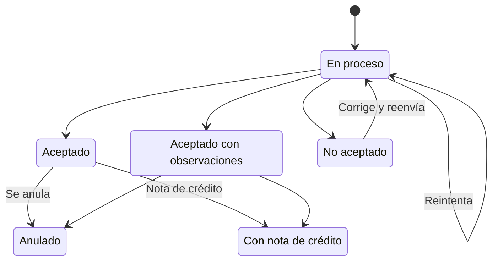

# 05 · Comprobantes SUNAT, devoluciones y cambios

Volver al [índice](00-indice-roles-y-decisiones.md).

> **Nota:** las reglas de SUNAT (plazos, anulación, notas de crédito) están marcadas **(validar)**. Las debe confirmar tu contador o tu proveedor proveedor de facturación antes de implementarlas.

---

## H1 · Ciclo de vida de un comprobante

**Cómo se ve (REG-06, REG-10)**

| Estado | Etiqueta en pantalla | Color e ícono | Qué puede hacer el usuario |
|---|---|---|---|
| pendiente | **En proceso** | Ámbar ⏳ | Esperar, **Reenviar** |
| aceptado | **Aceptado por SUNAT** | Verde ✔ | Imprimir, enviar, anular o nota de crédito |
| con observaciones | **Aceptado con observaciones** | Ámbar ⚠ | Igual que aceptado, con aviso de revisar |
| no aceptado | **No aceptado** | Rojo ✖ | **Corregir y reenviar** |
| anulado | **Anulado** | Gris | Solo consulta |

**Reglas transversales:** un comprobante emitido **nunca se edita**. La numeración es **consecutiva**: si un envío falla, el número queda reservado y se reenvía con el mismo (DEC-24).

**Dónde aparece:** ticket y detalle de venta, historial, contador de pendientes en el encabezado y en el resumen del día.

---

## H2 · Bandeja de pendientes y errores

**Rol:** SUP, ADM (CAJ ve los suyos)

**Pantalla:** lista con **filtro por estado** (Pendientes, No aceptados, Todos), número, cliente, total, **días transcurridos** y causa.

| Acción | Detalle |
|---|---|
| **Reenviar** uno o varios | Con progreso y resultado por fila |
| **Reenvío automático** | En segundo plano cada cierto tiempo. La pantalla muestra "Último intento hace 4 min" |
| Resaltado | Rojo cuando se acerca el plazo de envío (validar plazos con el proveedor de facturación) |

**Excepciones**

| # | Situación | Resultado |
|---|---|---|
| E1 | El reenvío falla otra vez | Se conserva el motivo más reciente. No se pierde el comprobante |
| E2 | Muchos pendientes por una caída larga | Botón **Reenviar todos** con vista del avance |
| E3 | Hay pendientes al cerrar caja | Aviso en B3, no bloquea |
| E4 | Un pendiente muy antiguo | Marca de alerta y guía a SUP |

---

## H3 · Comprobante rechazado u observado

**Rol:** SUP

| # | La persona | El sistema |
|---|---|---|
| 1 | Abre un comprobante **No aceptado** | Muestra el **motivo en lenguaje claro**, por ejemplo "El RUC del cliente no es válido" o "El total no coincide" |
| 2 | Pulsa **Corregir** | Abre solo lo que se puede corregir según el motivo (datos del cliente, por ejemplo) |
| 3 | **Corregir y reenviar** | Se reenvía normalmente con el mismo número (validar) |

**Observado:** se avisa sin bloquear. Se muestra qué revisar y no hay que reenviar.

**Excepciones**

| # | Situación | Resultado |
|---|---|---|
| E1 | El motivo no se puede corregir en pantalla (monto) | Se guía a **anular y reemitir** (H5) |
| E2 | El cliente ya se llevó la prenda | La venta existe y el stock ya bajó. La corrección no afecta la entrega |
| E3 | La corrección vuelve a fallar | Se muestra el nuevo motivo |
| E4 | El mismo motivo se repite en varios comprobantes | Aviso en el resumen "5 comprobantes con RUC inválido" |

---

## H4 · Reimprimir, reenviar y descargar

**Rol:** todos

Desde el detalle de una venta o el historial:

| Acción | Detalle |
|---|---|
| **Imprimir** | Ticket de 80 mm o A4. Sale con la leyenda **REIMPRESIÓN** |
| **WhatsApp** | Abre el chat con el enlace al PDF. Pide teléfono si falta |
| **Correo** | Con el correo del cliente |
| **Descargar** | PDF y XML (cuando existan) |

**Excepciones:** el PDF aún no se generó (botón "Generando…"); el XML no existe todavía (comprobante pendiente: se explica); el enlace caducó (se regenera); cliente sin teléfono ni correo.

---

## H5 · Anular o emitir una nota de crédito

**Rol:** SUP, ADM

La persona no debería tener que saber si lo que corresponde es "baja" o "nota de crédito". La pantalla es un **asistente de preguntas**:

**Pregunta: "¿Qué pasó?"**

| Respuesta | Camino |
|---|---|
| El cliente devolvió **todo** | Devolución total (I1) |
| El cliente devolvió **una parte** | Devolución parcial (I2) |
| Se cambió de prenda | Cambio (I3) |
| **Error en los datos del cliente** | Nota de crédito de corrección y nueva emisión |
| **Error en el monto o en las prendas** | Anular y emitir de nuevo |
| **El cliente pidió factura después de la boleta** | Ver abajo |

**Qué decide el sistema por su cuenta (validar):**

| Situación | Mecanismo probable |
|---|---|
| Boleta o factura del **mismo día y sin entrega relevante** | **Anulación** |
| Factura dentro del plazo permitido | **Anulación ante SUNAT** |
| Fuera de plazo o con devolución | **Nota de crédito** |

La pantalla muestra solo el resultado: "Se anulará la boleta B001-00000431. El stock volverá a la tienda y se devolverán S/ 129.00."

**Flujo común (resumen):** motivo obligatorio → clave del supervisor → resumen del efecto (stock, caja, comprobante) → **Confirmar** → se actualizan el estado del comprobante y de la venta, el historial de movimientos y la caja.

**Caso especial · Cambio de boleta a factura**

| # | Paso |
|---|---|
| 1 | Se anula la boleta (o se emite nota de crédito) |
| 2 | Se crea una **venta nueva con las mismas prendas** ya cargadas |
| 3 | Se elige el cliente con RUC |
| 4 | Se cobra con el mismo medio de pago, sin mover dinero real. El sistema indica "El pago se traslada desde la boleta anulada" |
| 5 | Se emite la factura |

**Excepciones**

| # | Situación | Resultado |
|---|---|---|
| E1 | Comprobante ya anulado o con nota de crédito | Bloquea con el estado actual |
| E2 | Comprobante pendiente (aún sin aceptación) | "Primero debe aceptarse o corregirse" |
| E3 | Fuera del plazo de baja | Solo ofrece nota de crédito |
| E4 | Sin conexión | No se anula. Aviso "Necesitas conexión" |
| E5 | La venta es de un turno ya cerrado | El efecto de caja (reembolso) cae en la **sesión actual** y se explica |
| E6 | No hay efectivo suficiente para reembolsar | Opciones: otro medio, o esperar a que haya |
| E7 | La persona no tiene permiso | Pide clave del supervisor |
| E8 | La anulación afecta a un pack | Se explica qué componentes regresan al stock |

---

## H6 · Modo sin conexión (sin SUNAT o sin internet)

**Rol:** todos

Dos niveles distintos, que la interfaz distingue:

| Nivel | Qué pasa | Qué ve la persona |
|---|---|---|
| **1. SUNAT no responde, pero el sistema sí** | Se puede vender normal. Los comprobantes quedan **En proceso** | Aviso ámbar "SUNAT no responde. Sigues vendiendo, los comprobantes se enviarán después" |
| **2. Sin internet** | El punto de venta no puede confirmar ventas en el servidor | Aviso rojo. **Decisión de negocio:** (a) bloquear ventas o (b) un modo local limitado con cola |

**Modo local (opcional, si el negocio lo decide)**

- Límite de ventas o de tiempo (propuesta: hasta 20 ventas o 2 horas).
- Aviso permanente "Modo sin conexión: el stock puede no estar actualizado".
- Al reconectar: sincronización con un resumen "18 ventas enviadas, 2 con problemas".
- Conflictos (stock que quedó negativo): se listan para que SUP los regularice.

**Excepciones:** factura emitida en modo sin conexión (se requiere cliente con RUC; se avisa que se enviará luego); la caja se cierra sin conexión (B3 E6); intermitencia constante (el aviso no parpadea, tiene un estado estable por 30 segundos).

---

# Devoluciones y cambios

El modelo no tiene tablas de devolución (DEC-07). La experiencia las trata como un **asistente único** que, por debajo, produce nota de crédito, movimiento de stock y movimiento de caja. El usuario ve una sola operación.

## I1 · Devolución total con comprobante

**Rol:** CAJ (dentro del plazo), SUP

**Flujo principal**

| # | La persona | El sistema |
|---|---|---|
| 1 | **Devoluciones** → busca la venta | Por número, **escaneo del QR del ticket**, documento del cliente, fecha o monto |
| 2 | Abre la venta | Muestra líneas, pagos y **días transcurridos**: "Compra de hace 5 días. Plazo: 7 días" (propuesta) |
| 3 | Marca **Devolver todo** | Todas las líneas seleccionadas |
| 4 | Elige el **motivo** | Talla, defecto, no le gustó, error de la tienda, otro |
| 5 | Indica la **condición** de cada prenda | Reingresa a stock · Dañada (prenda dañada) · En revisión |
| 6 | Revisa el **monto a devolver** | Considera el descuento proporcional. Muestra "S/ 119.70" |
| 7 | Elige el **medio de reembolso** | Ver I5 |
| 8 | **Confirmar** (clave del supervisor si aplica) | Emite la nota de crédito, mueve el stock, registra el egreso de caja, actualiza la venta a devuelta |
| 9 | — | Imprime la nota de crédito y el comprobante de devolución |

## I2 · Devolución parcial

Igual que I1, pero la persona elige **líneas y cantidades**.

**Excepciones comunes de I1 e I2**

| # | Situación | Resultado |
|---|---|---|
| E1 | Fuera de plazo | Solo SUP, con motivo |
| E2 | Prenda sin etiqueta o usada | SUP decide. Queda anotado |
| E3 | La venta es de otra sede | Se acepta, y el stock reingresa a la sede donde se devuelve. Se anota la sede de origen |
| E4 | Cantidad mayor a la comprada | No se permite |
| E5 | Ya hubo una devolución parcial | Muestra "Ya se devolvió 1 de 2" y solo permite el resto |
| E6 | La venta está pendiente de SUNAT | "Primero debe aceptarse" (H5 E2) |
| E7 | El comprobante es ilegible o se perdió | Búsqueda por cliente, fecha y monto |
| E8 | Venta con delivery ya entregado | Se permite. El costo de envío no se devuelve salvo política contraria (J7) |
| E9 | Prenda de un pack | Regla de pack: ver I7 |
| E10 | Descuento global | Se reparte entre las líneas devueltas. El detalle se muestra |

## I3 · Cambio de talla o color (el caso más frecuente)

**Rol:** CAJ, SUP

Para la persona es **una sola operación**: "Cambiar prenda".

| # | La persona | El sistema |
|---|---|---|
| 1 | Busca la venta y pulsa **Cambiar** en la prenda | Muestra la prenda original |
| 2 | Elige la **prenda nueva** (escanea o busca) | Muestra el **stock por talla y color** de esa prenda |
| 3 | — | Calcula la **diferencia**: "Mismo precio", "Debe pagar S/ 20", o "Se le devuelven S/ 10" |
| 4 | Confirma (clave del supervisor si aplica) | Por debajo: devolución de la prenda original, nueva venta, ajuste de stock y de caja por la diferencia |
| 5 | — | Imprime los comprobantes correspondientes |

**Excepciones**

| # | Situación | Resultado |
|---|---|---|
| E1 | La prenda nueva no tiene stock | Ofrece otras tallas y colores, la consulta en otras sedes, o convertir en devolución simple |
| E2 | El precio actual de la prenda original bajó | Aviso "Pagó S/ 129 y hoy cuesta S/ 99". Se cambia por el valor pagado |
| E3 | La diferencia es a favor de la clienta y no hay efectivo | Se ofrece otro medio o dejar la diferencia como pregunta abierta (archivo 07) |
| E4 | Cambio fuera de plazo | Solo SUP |
| E5 | Varios cambios en una misma venta | Se hacen en un solo asistente, con un resumen al final |
| E6 | La clienta quiere ahora factura | Se aplica H5 "cambio de boleta a factura" dentro del mismo proceso |
| E7 | Cambio con descuento original | El descuento se mantiene proporcional. Se muestra el cálculo |
| E8 | Cambio de color con stock en otra sede | Solo informativo. No se reserva ni traslada |

## I4 · Devolución o cambio sin comprobante

**Rol:** SUP, ADM (nunca CAJ)

Sin comprobante no se puede emitir una nota de crédito referenciada. Propuesta de política (**confirmar**):

| Opción | Permitida |
|---|---|
| Cambio por otra prenda de igual o menor valor | ✅, con DNI de la clienta |
| Reembolso en dinero | ❌ |
| Diferencia a favor de la clienta | ❌ (se elige otra prenda para igualar) |

La pantalla pide documento de la clienta, motivo y condición de la prenda. Se registra el movimiento de stock con nota.
**X1 · Clienta sin ticket pero con la compra en el sistema:** se busca por documento o por fecha y se continúa como I1 o I3.

## I5 · Reembolso por medio de pago

| Medio original | Qué hace la persona | Efecto en caja |
|---|---|---|
| **Efectivo** | Entrega el efectivo | Egreso en efectivo |
| **Yape o Plin** | Hace la devolución desde su app y anota el N.º de operación | Sin egreso de efectivo |
| **Tarjeta** | Anula o reembolsa en el terminal y anota el voucher | Sin egreso de efectivo |
| **Pago mixto** | Elige por cada parte: el mismo medio de origen o efectivo | Según lo elegido |

**Excepciones:** el reembolso en efectivo supera el efectivo de caja (E6 de H5); la persona reembolsa por un medio distinto al original (permitido solo con clave del supervisor y motivo); no se anota la referencia de la operación (se pide como obligatoria para medios digitales).

## I6 · Prenda dañada o con defecto

Al devolver, la persona marca la **condición** de cada prenda:

| Condición | Efecto |
|---|---|
| Reingresa a stock | Sube el stock y se anota el historial de movimientos como devolución |
| Dañada | Se anota la devolución y luego la prenda dañada. El stock no sube |
| En revisión | Queda fuera del stock vendible hasta que SUP decida |

**Excepción:** devolver al proveedor una prenda defectuosa sigue por C6 como salida con motivo.

## I7 · Devolución parcial de un pack

El modelo no guarda la relación de la línea con el pack (DEC-18). La experiencia explica la regla antes de confirmar:

- **Se devuelve el pack completo** a su precio promocional, o
- **Se devuelve un componente** al valor proporcional del pack, y el pack deja de cumplir su promoción. La diferencia se muestra con claridad.

Casos extraños: devolver un componente de un pack ya parcialmente devuelto; pack con un componente en oferta aparte; pack comprado con descuento global.
