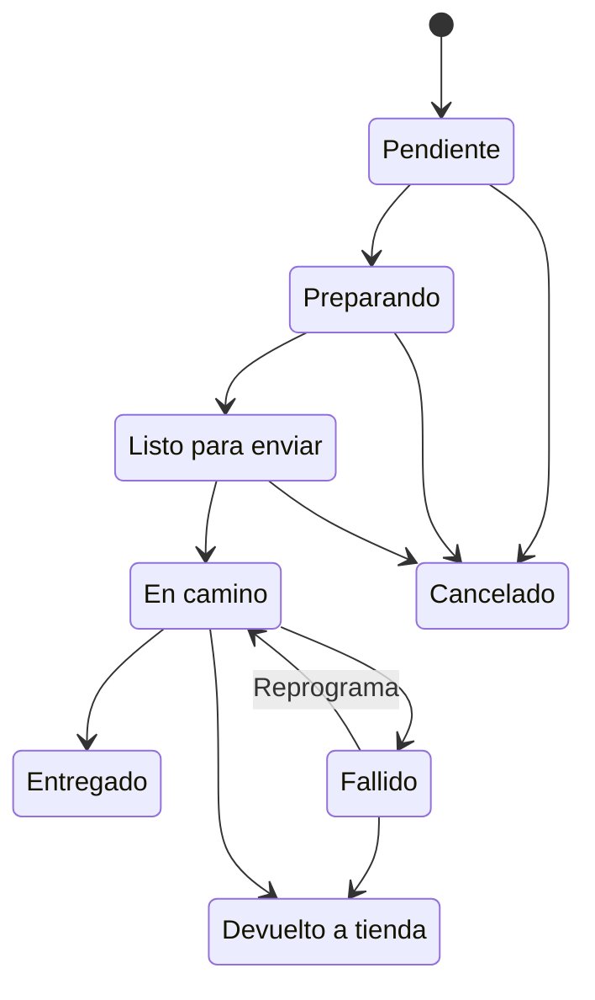

# 06 · Delivery

Volver al [índice](00-indice-roles-y-decisiones.md).

**Qué es un pedido con delivery:** una venta con **un solo envío** (DEC-27). Cada envío tiene dirección, referencia, costo, courier, guía, fecha estimada y fecha real, y un historial de estados con persona y observación.

## Estados de un pedido

Los nombres son una **propuesta**; en la práctica salen de `delivery_estado`, que ADM configura con su **orden** (A4). La interfaz respeta ese orden: avanzar al siguiente es un clic, retroceder o saltar pide motivo y clave del supervisor.

---

## J1 · Crear una venta con envío

**Rol:** CAJ, SUP

**Flujo principal**

| # | La persona | El sistema |
|---|---|---|
| 1 | En el carrito activa **Envío** (o elige canal no físico, G9) | Abre el panel **Datos de envío** |
| 2 | Elige o registra al **cliente** | Cliente obligatorio, con teléfono obligatorio |
| 3 | Escribe **dirección**, **referencia** y distrito | Exige un mínimo (calle o referencia y distrito) |
| 4 | Indica el **costo de envío** | Campo numérico, o el interruptor **Envío gratis** |
| 5 | (Opcional) elige el **courier** o lo deja "Por asignar" | Autocompleta con los usados antes |
| 6 | Indica la **fecha estimada** | Sugerida según el día |
| 7 | Ve el resumen: **Productos + Envío = Total a cobrar** (DEC-19) | Separa las líneas |
| 8 | Elige **Pagar ahora** o **Contra entrega** | Contra entrega: J8 |
| 9 | Cobra (G5) | Crea la venta y el envío en estado inicial |

**Excepciones**

| # | Situación | Resultado |
|---|---|---|
| E1 | Cliente sin teléfono | Obligatorio: pide el número |
| E2 | Dirección incompleta | Error junto al campo, indica qué falta |
| E3 | Costo de envío vacío | Pregunta "¿El envío es gratis?" para evitar un cero accidental |
| E4 | Zona sin cobertura | No hay zonas en el sistema: aviso informativo manual del courier |
| E5 | Fecha estimada en domingo o feriado | Aviso, no bloquea |
| E6 | La dirección es distinta a la fiscal del cliente | Se permite. Se guarda solo en el envío |
| E7 | Pedido a provincia con agencia | Courier y guía llegan después; **no** se ofrece contra entrega |
| E8 | La venta es a una persona y el envío a otra | No hay campo de destinatario: se anota en la referencia |
| E9 | Cambió la dirección después de crear el pedido | **Editar envío** solo hasta antes de "En camino", con registro en el historial |
| E10 | Comprador pide factura | Igual que G4 |

**Casos extraños**

- **X1 · Un pedido grande en dos paquetes con couriers distintos:** no está soportado (un envío por venta). La pantalla lo explica y sugiere crear dos pedidos.
- **X2 · Mismo cliente con dos pedidos el mismo día:** se avisa "Este cliente ya tiene un pedido pendiente. ¿Unirlos?".
- **X3 · Se cobra el envío pero lo paga la tienda en realidad:** se registra como envío gratis; la diferencia se anota en un movimiento de caja si se paga al courier en efectivo.

---

## J2 · Estados y avance

**Rol:** CAJ hasta "En camino", SUP para el resto

**Vista:** tablero por columnas (un estado por columna) y una vista de lista. Cada tarjeta muestra número de venta, cliente, distrito, courier, fecha estimada y **días de retraso** si corresponde.

| Acción | Regla |
|---|---|
| **Avanzar** | Un botón con el nombre del siguiente estado: "Marcar como Preparando" |
| **Retroceder o saltar** | Pide motivo y clave del supervisor |
| **Cada cambio** | Guarda en el historial: estado, persona, hora y observación (REG-12) |
| **Notificar al cliente** | En estados clave ("En camino", "Entregado") ofrece un mensaje de WhatsApp ya redactado, que la persona revisa antes de enviar |

**Excepciones**

| # | Situación | Resultado |
|---|---|---|
| E1 | Dos personas cambian el estado a la vez | La segunda ve "El pedido ya está En camino. [Actualizar]" |
| E2 | Se avanza por error | **Deshacer** por 10 minutos con motivo. Queda en el historial |
| E3 | Pedido sin courier al pasar a "En camino" | Pide courier y guía antes de continuar |
| E4 | Se cambió el orden de los estados con pedidos en curso | Los pedidos conservan el estado actual. Aviso a ADM al reordenar (A4 E) |

---

## J3 · Preparar, asignar courier y guía

**Rol:** CAJ, SUP

| # | La persona | El sistema |
|---|---|---|
| 1 | Abre el pedido en **Preparando** | Muestra la **lista de prendas** con lista de verificación |
| 2 | **Escanea cada prenda** | Marca como preparada. Alerta si escanea algo que no es del pedido |
| 3 | Pasa a **Listo para envío** | Ofrece **Imprimir etiqueta y hoja de pedido** |
| 4 | Asigna **courier** y **número de guía** | Autocompleta, con el tipo: "Motorizado propio" o "Courier externo" |
| 5 | **Marcar En camino** | Notifica al cliente (opcional) |

**Excepciones**

| # | Situación | Resultado |
|---|---|---|
| E1 | Falta una prenda al preparar | "No encontramos la talla M. [Cambiar prenda] [Quitar del pedido]" y ver I3 |
| E2 | El stock físico no alcanza aunque el sistema lo mostró | Se contacta a la clienta y se resuelve con cambio o devolución parcial (I2) |
| E3 | Guía repetida | "Esta guía ya se usó en el pedido 421" |
| E4 | Courier cambió la guía | Se actualiza y queda en el historial |
| E5 | Courier nuevo no listado | Se escribe libre y se guarda para la próxima |

---

## J4 · Entrega exitosa

**Rol:** CAJ, SUP

| # | La persona | El sistema |
|---|---|---|
| 1 | Marca **Entregado** | Registra la **fecha real de entrega** automáticamente |
| 2 | (Opcional) agrega nota | "Recibió su hermana" |
| 3 | Si era contra entrega | Pide registrar el cobro (J8) |

**Excepciones:** se marcó entregado por error (Deshacer 10 minutos); fecha real anterior a la de creación (se corrige con la hora actual y se avisa); sin conexión del repartidor (la persona de tienda lo marca cuando se entera).
**X1 · Entrega sin firma ni foto:** no hay campo. Se invita a anotar en la observación.

---

## J5 · Entrega fallida y reprogramación

**Rol:** CAJ, SUP

**Motivos:** no estaba, dirección errónea, no contesta, rechazó el pedido, otro.

| # | La persona | El sistema |
|---|---|---|
| 1 | Marca **Fallido** y elige el motivo | Guarda el intento en el historial |
| 2 | Elige **Reprogramar** o **Devolver a tienda** | Reprogramar pide nueva fecha y notifica al cliente |
| 3 | Si se devuelve a tienda | Estado "Devuelto a tienda": decide I1 o reponer |

**Excepciones**

| # | Situación | Resultado |
|---|---|---|
| E1 | Dos intentos fallidos | Sugiere devolver a tienda (propuesta) |
| E2 | Costo extra por reprogramar | Se anota como egreso de caja o ajuste del pedido |
| E3 | El cliente no responde en 3 días | Aviso a SUP y opción de cancelar |
| E4 | Dirección errónea | Edita la dirección, con registro |

---

## J6 · Cancelar un pedido

**Rol:** SUP (CAJ solo si no está pagado)

| Momento | Qué pasa |
|---|---|
| **Antes de preparar o mientras prepara** | Cancela. El stock vuelve, se anula o emite nota de crédito y se reembolsa (H5, I5) |
| **Ya "En camino"** | No se cancela: se marca **Devuelto a tienda** al regresar, y recién ahí se resuelve |
| **Ya entregado** | Es una devolución (I1) |

**Excepciones:** pedido pagado con digital (reembolso por el mismo medio); motivo siempre obligatorio; el cliente cancela por WhatsApp (se registra con motivo "Cancelado por el cliente").
**X1 · El courier se pierde el paquete:** estado **Extraviado** (si existe en la configuración), con nota de crédito o reposición según decida SUP.

---

## J7 · Devolución de un pedido entregado

Sigue **I1** o **I2**, con estas diferencias:

| Tema | Regla propuesta |
|---|---|
| Costo de envío | **No se reembolsa** por defecto. Si el motivo es "error de la tienda", sí. Configurable |
| Recojo de la prenda | Si hay que recogerla, se crea una tarea y se anota el costo |
| Estado del pedido | Cambia a Devuelto, con registro |

---

## J8 · Pago contra entrega

**Rol:** CAJ, SUP

El modelo exige un medio de pago para cada pago registrado, así que el pedido contra entrega vive en estado **pago pendiente** (DEC-20).

| # | Momento | Qué pasa |
|---|---|---|
| 1 | Al crear el pedido | Elige **Contra entrega**. Se anota el monto a cobrar. No entra dinero a la caja |
| 2 | Al entregar | El repartidor cobra |
| 3 | Cuando el repartidor **rinde** | La persona de caja registra el pago con el medio (efectivo, Yape…). La venta pasa a completada y el efectivo entra a la **caja que recibe** |

**Reglas:** límite de monto por pedido (propuesta S/ 500) y solo para zonas cercanas.

**Excepciones**

| # | Situación | Resultado |
|---|---|---|
| E1 | El repartidor no rinde el mismo día | Aparece en "Efectivo por rendir" y en el cierre de caja (B3) |
| E2 | El cliente paga una parte | Pago mixto (G5) |
| E3 | El cliente rechaza el pedido | J5 o J6. No hay dinero que devolver |
| E4 | El repartidor devuelve menos de lo cobrado | Diferencia con observación y aviso a SUP |
| E5 | El comprobante debe emitirse antes de cobrar | La decisión fiscal es del contador (pregunta abierta, archivo 07) |

---

## J9 · Seguimiento y búsqueda

**Rol:** todos

Pantalla de **Pedidos** con:

| Elemento | Detalle |
|---|---|
| Búsqueda | Por número de venta, nombre, teléfono o guía |
| Filtros | Estado, courier, fecha estimada, atrasados |
| Contadores | Cantidad por estado, visible en el menú |
| **Atrasados** | Fecha estimada vencida y sin entregar: se resaltan en rojo con ícono |

**Excepciones:** sin resultados (estado vacío con acción); pedidos de otra sede (solo ADM con selector).

---

## J10 · Línea de tiempo del pedido

En el detalle, una **línea de tiempo** con cada cambio: estado, persona, hora y observación, tomados del historial. Incluye eventos de notificación al cliente.

**Excepciones:** pedido sin historial por datos antiguos (se muestra el estado actual con la fecha de creación); observaciones largas (se pliegan); el historial no se edita ni se borra (REG-12).
