# AgaShop · Flujos simples (Mermaid)

## F1 · Empezar el día: abrir la caja

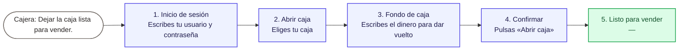

## F2 · Vender una prenda

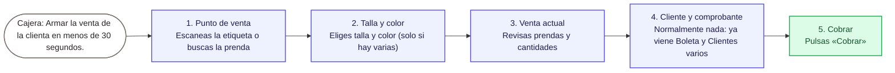

## F3 · Cobrar y entregar el comprobante

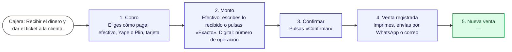

## F4 · Cambiar una prenda por otra talla o color

```mermaid
flowchart LR
  I(["Cajera: Darle a la clienta la prenda correcta sin perder el control de stock y de caja."]):::ini --> N1
  N1["1. Devoluciones<br/>Buscas la venta: número, QR del ticket o DNI"]:::paso
  N1 --> N2
  N2["2. Prenda a cambiar<br/>Pulsas «Cambiar» en la prenda"]:::paso
  N2 --> N3
  N3["3. Prenda nueva<br/>Escaneas o buscas la nueva"]:::paso
  N3 --> N4
  N4["4. Diferencia<br/>Revisas: mismo precio, debe pagar o se devuelve"]:::paso
  N4 --> N5
  N5["5. Confirmar<br/>Pulsas «Confirmar» (clave del supervisor si lo pide)"]:::paso
  N5 --> N6
  N6["6. Listo<br/>Imprimes los comprobantes"]:::fin
classDef paso fill:#eef2ff,stroke:#4f46e5,color:#1e1b4b,stroke-width:1.5px;
classDef fin fill:#dcfce7,stroke:#16a34a,color:#14532d,stroke-width:1.5px;
classDef ini fill:#fff,stroke:#78716c,color:#292524,stroke-width:1.5px;
```

## F5 · Devolver una prenda

```mermaid
flowchart LR
  I(["Cajera: Devolver el dinero y reponer el stock."]):::ini --> N1
  N1["1. Devoluciones<br/>Buscas la venta"]:::paso
  N1 --> N2
  N2["2. Prendas<br/>Marcas qué prendas y cuántas devuelve"]:::paso
  N2 --> N3
  N3["3. Motivo y estado<br/>Eliges el motivo y cómo está la prenda"]:::paso
  N3 --> N4
  N4["4. Reembolso<br/>Eliges cómo devolver el dinero"]:::paso
  N4 --> N5
  N5["5. Confirmar<br/>Pulsas «Confirmar» (clave del supervisor si lo pide)"]:::paso
  N5 --> N6
  N6["6. Listo<br/>Imprimes la nota"]:::fin
classDef paso fill:#eef2ff,stroke:#4f46e5,color:#1e1b4b,stroke-width:1.5px;
classDef fin fill:#dcfce7,stroke:#16a34a,color:#14532d,stroke-width:1.5px;
classDef ini fill:#fff,stroke:#78716c,color:#292524,stroke-width:1.5px;
```

## F6 · Cerrar la caja

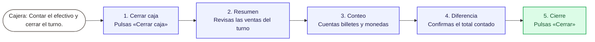

## F7 · Recibir mercadería (registrar una compra)

```mermaid
flowchart LR
  I(["Supervisor/a: Subir el stock con el costo correcto."]):::ini --> N1
  N1["1. Compras<br/>Pulsas «Nueva compra»"]:::paso
  N1 --> N2
  N2["2. Proveedor<br/>Escribes el RUC"]:::paso
  N2 --> N3
  N3["3. Documento<br/>Escribes tipo, serie, número y fecha"]:::paso
  N3 --> N4
  N4["4. Prendas<br/>Escaneas o buscas y pones cantidad y costo"]:::paso
  N4 --> N5
  N5["5. Verificar<br/>Comparas con el total del documento"]:::paso
  N5 --> N6
  N6["6. Registrar<br/>Pulsas «Registrar compra»"]:::fin
classDef paso fill:#eef2ff,stroke:#4f46e5,color:#1e1b4b,stroke-width:1.5px;
classDef fin fill:#dcfce7,stroke:#16a34a,color:#14532d,stroke-width:1.5px;
classDef ini fill:#fff,stroke:#78716c,color:#292524,stroke-width:1.5px;
```

## F8 · Crear un producto nuevo

```mermaid
flowchart LR
  I(["Supervisor/a: Dejar la prenda lista para vender, con todas sus tallas y colores."]):::ini --> N1
  N1["1. Productos<br/>Pulsas «Nuevo producto»"]:::paso
  N1 --> N2
  N2["2. Datos<br/>Escribes nombre y eliges categoría"]:::paso
  N2 --> N3
  N3["3. Tallas y colores<br/>Eliges tallas y colores"]:::paso
  N3 --> N4
  N4["4. Precios y stock<br/>Escribes precio, costo y stock"]:::paso
  N4 --> N5
  N5["5. Revisar<br/>Confirmas el resumen"]:::paso
  N5 --> N6
  N6["6. Guardar<br/>Pulsas «Guardar»"]:::fin
classDef paso fill:#eef2ff,stroke:#4f46e5,color:#1e1b4b,stroke-width:1.5px;
classDef fin fill:#dcfce7,stroke:#16a34a,color:#14532d,stroke-width:1.5px;
classDef ini fill:#fff,stroke:#78716c,color:#292524,stroke-width:1.5px;
```

## F9 · Ajustar el stock

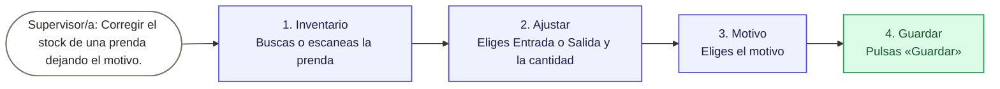

## F10 · Revisar el historial de movimientos de una prenda

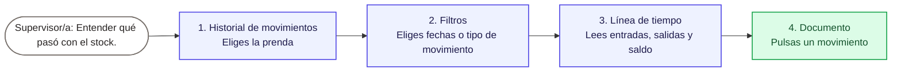

## F11 · Corregir o anular un comprobante

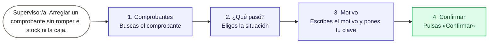

## F12 · Atender un pedido con delivery

```mermaid
flowchart LR
  I(["Supervisor/a: Llevar la prenda a la clienta y saber en qué paso va."]):::ini --> N1
  N1["1. Venta con envío<br/>Activas «Envío» y escribes dirección y costo"]:::paso
  N1 --> N2
  N2["2. Cobro<br/>Eliges pagar ahora o contra entrega"]:::paso
  N2 --> N3
  N3["3. Preparar<br/>Escaneas cada prenda del pedido"]:::paso
  N3 --> N4
  N4["4. Enviar<br/>Pones courier y guía y marcas «En camino»"]:::paso
  N4 --> N5
  N5["5. Entrega<br/>Marcas «Entregado»"]:::fin
classDef paso fill:#eef2ff,stroke:#4f46e5,color:#1e1b4b,stroke-width:1.5px;
classDef fin fill:#dcfce7,stroke:#16a34a,color:#14532d,stroke-width:1.5px;
classDef ini fill:#fff,stroke:#78716c,color:#292524,stroke-width:1.5px;
```

## F13 · Configurar una tienda nueva

```mermaid
flowchart LR
  I(["Administrador/a: Dejar la tienda lista para vender."]):::ini --> N1
  N1["1. Empresa y sede<br/>Escribes razón social, RUC y dirección"]:::paso
  N1 --> N2
  N2["2. Cajas y series<br/>Creas las cajas y su serie de boleta y factura"]:::paso
  N2 --> N3
  N3["3. Turnos<br/>Defines los horarios"]:::paso
  N3 --> N4
  N4["4. Medios de pago<br/>Activas efectivo, Yape, Plin, tarjeta"]:::paso
  N4 --> N5
  N5["5. Usuarios<br/>Creas a tu equipo con su rol"]:::paso
  N5 --> N6
  N6["6. Tienda lista<br/>—"]:::fin
classDef paso fill:#eef2ff,stroke:#4f46e5,color:#1e1b4b,stroke-width:1.5px;
classDef fin fill:#dcfce7,stroke:#16a34a,color:#14532d,stroke-width:1.5px;
classDef ini fill:#fff,stroke:#78716c,color:#292524,stroke-width:1.5px;
```

## F14 · Registrar un cliente

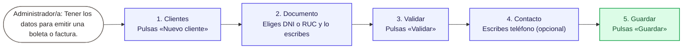

