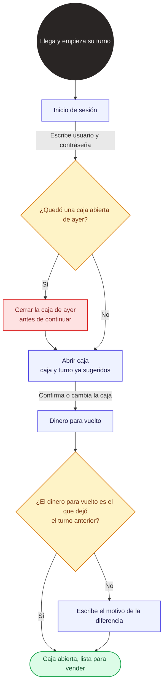
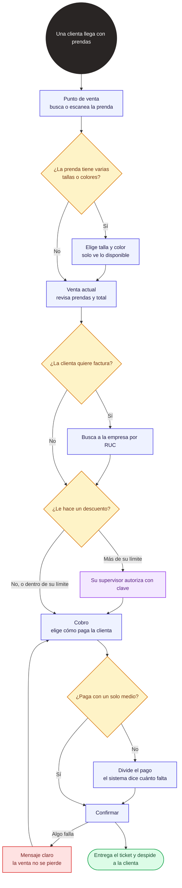
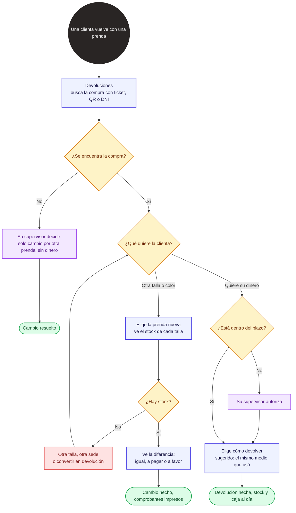
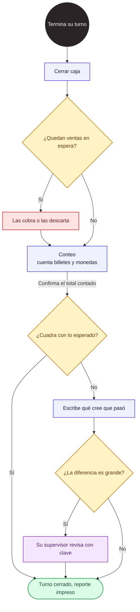
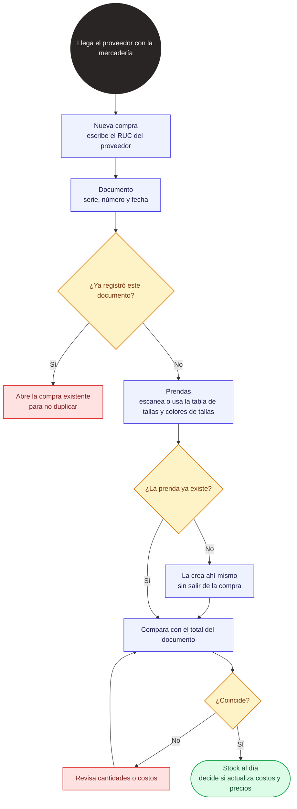
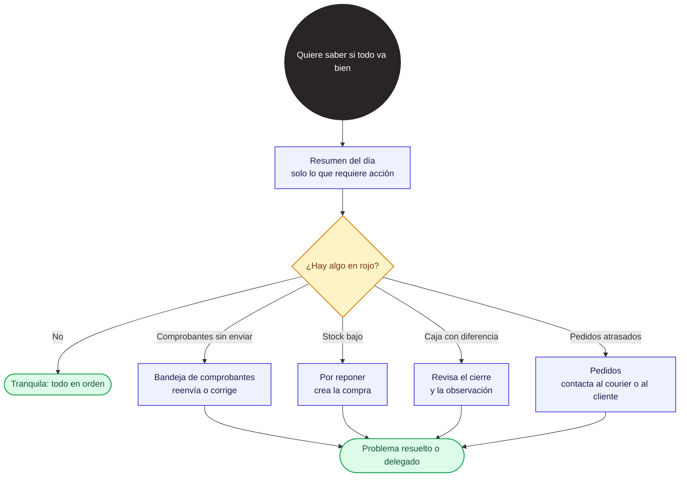
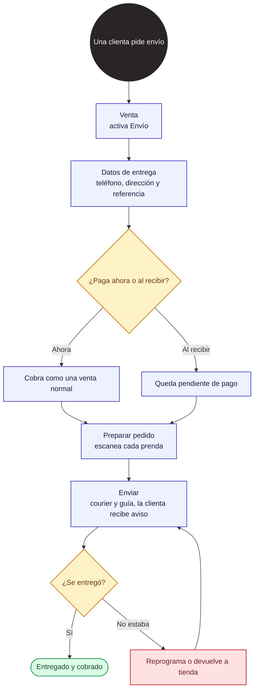
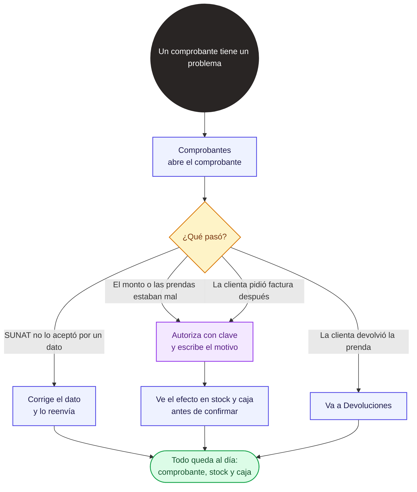
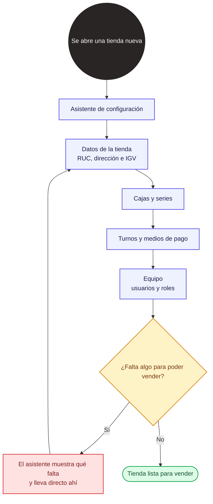

# AgaShop · Flujos de usuario (Mermaid)

## U1 · Quiero empezar a vender

## U2 · Una clienta quiere comprar

## U3 · Una clienta quiere cambiar o devolver

## U4 · Quiero cerrar mi turno sin problemas

## U5 · Llegó mercadería y quiero que el stock quede correcto

## U6 · Quiero saber si algo va mal hoy

## U7 · Una clienta pide que le lleven su pedido

## U8 · Algo salió mal con un comprobante

## U9 · Quiero abrir una tienda nueva

