# AgaShop · Diagramas (Mermaid)

## Mapa general: cómo se conectan los módulos

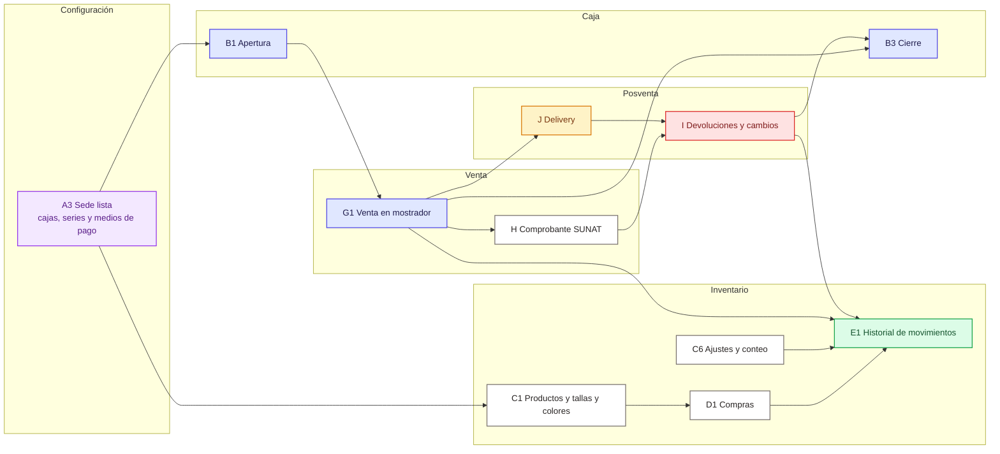

## Estados de la turno de caja

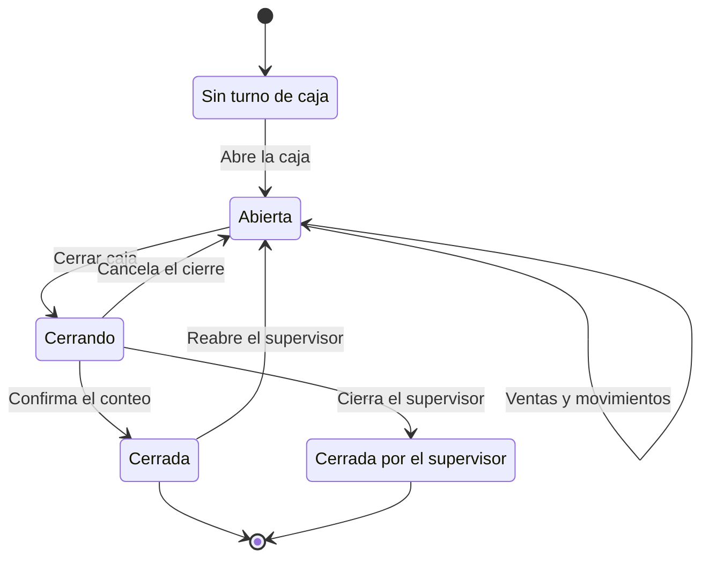

## Estados de una venta (propuesta)

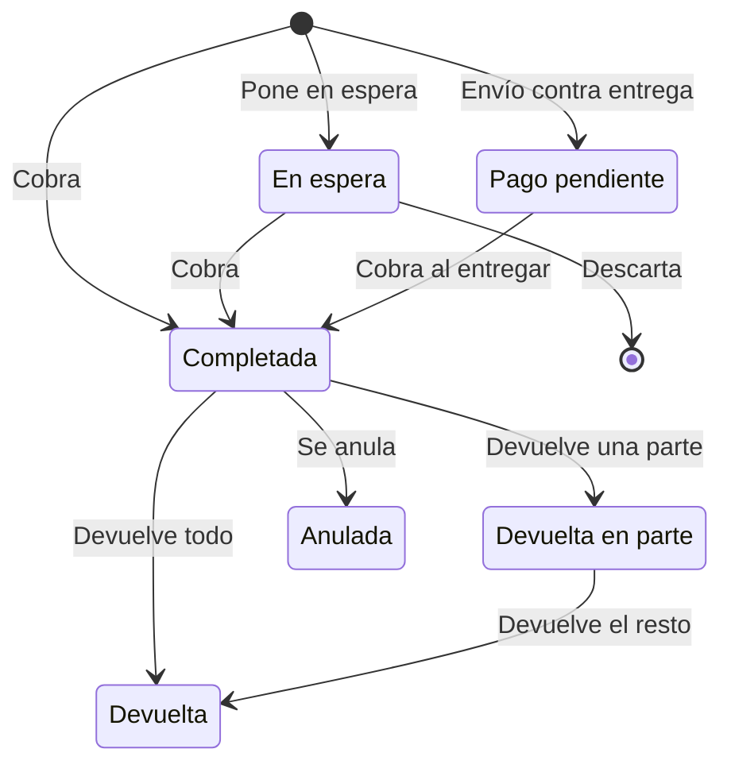

## Estados de un comprobante SUNAT

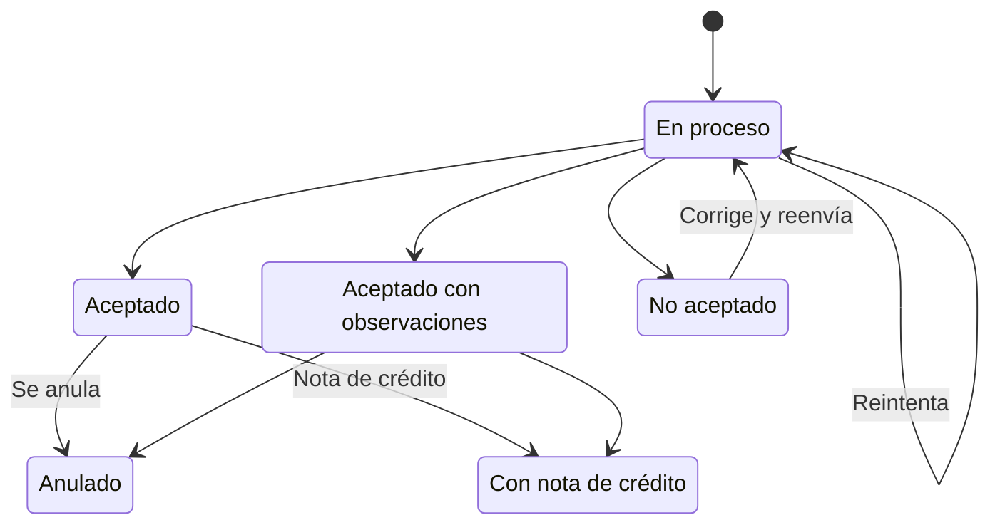

## Estados de un pedido con delivery

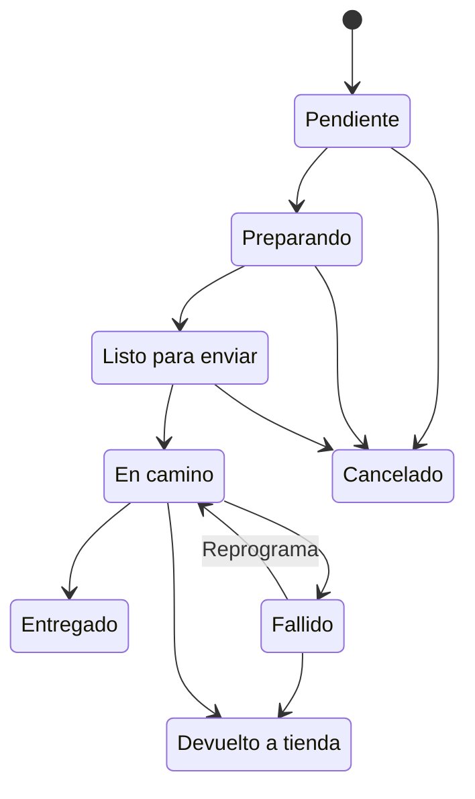

## A1 · Inicio de sesión

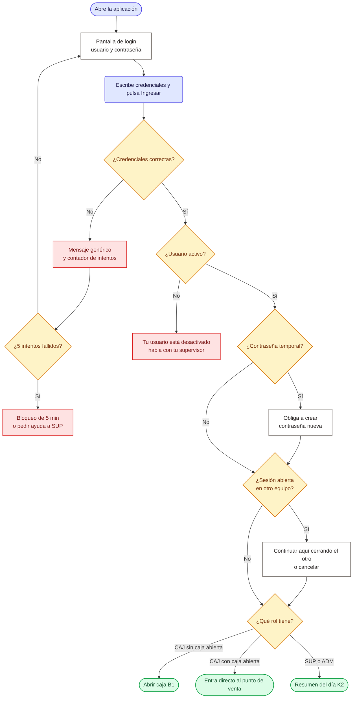

## A2 · Bloqueo rápido y cambio de persona

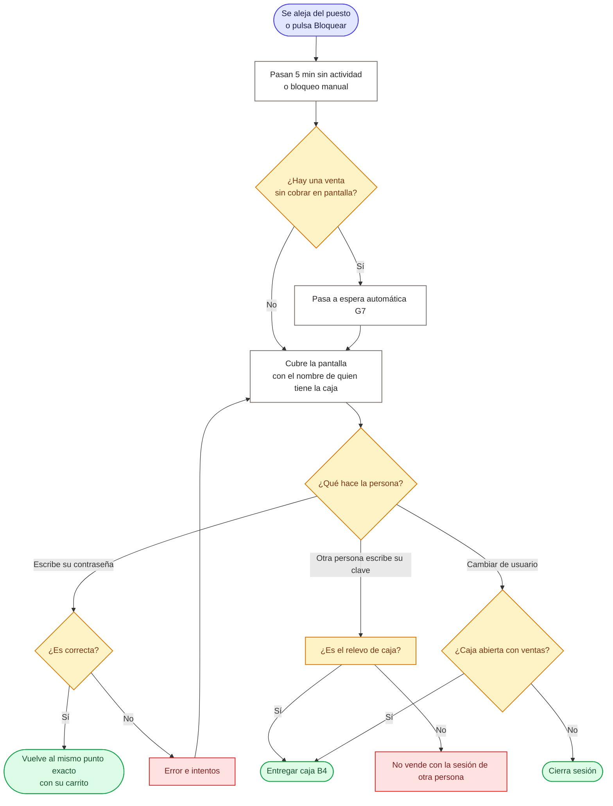

## A3 · Configuración inicial de una sede

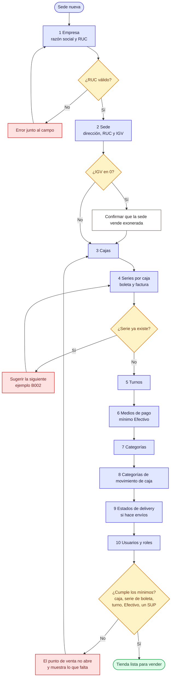

## A5 · Gestión de usuarios

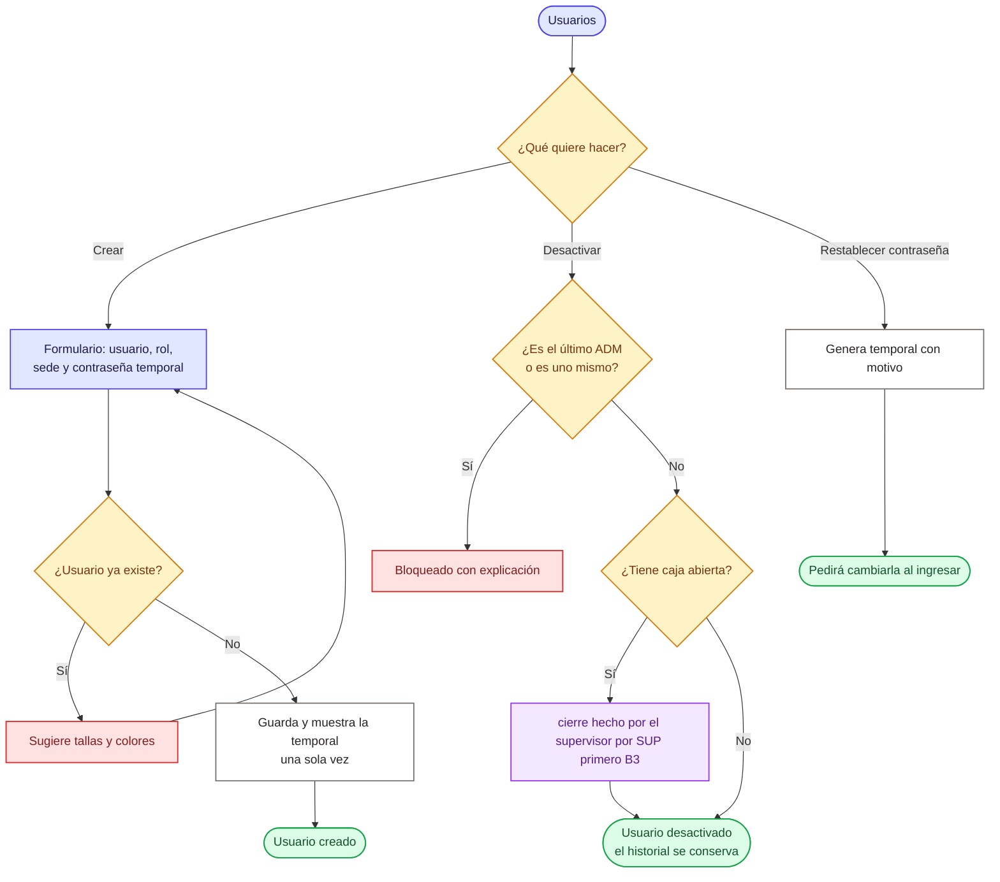

## B1 · Apertura de caja

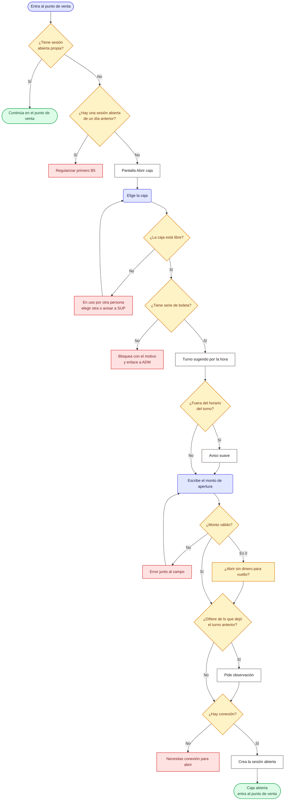

## B2 · Movimiento extra de caja

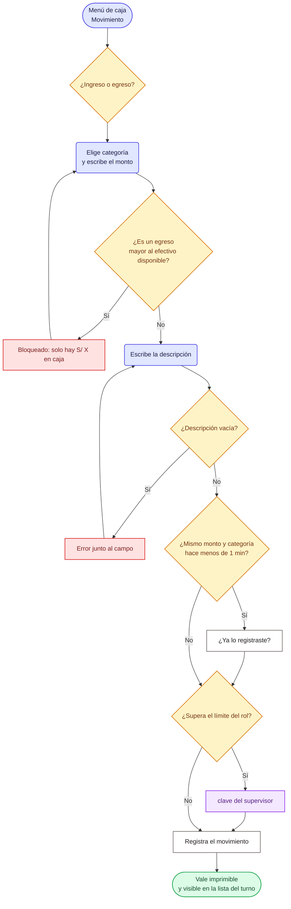

## B3 · Conteo y cierre de caja

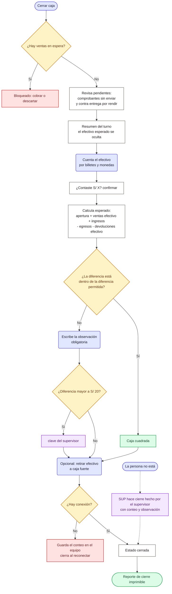

## B4 · Relevo de turno

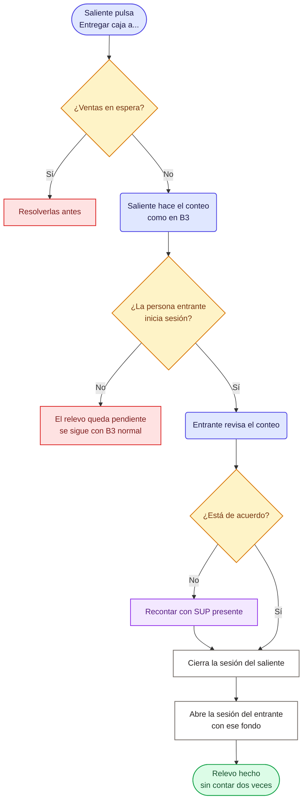

## B5 · Caja olvidada del día anterior

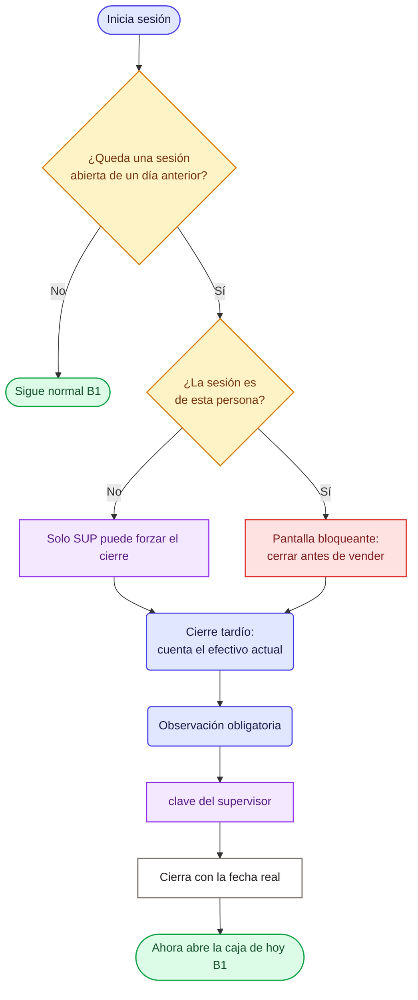

## B6 · Correcciones de caja

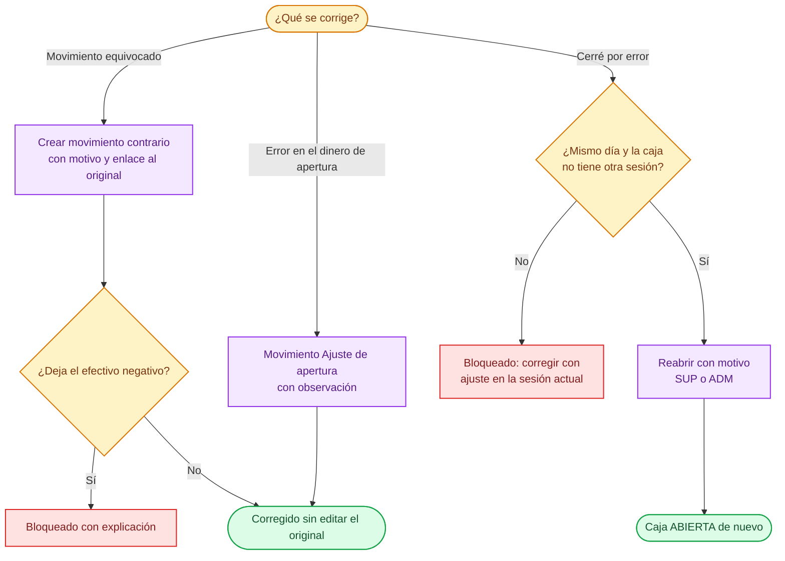

## C1 · Crear un producto con tallas y colores

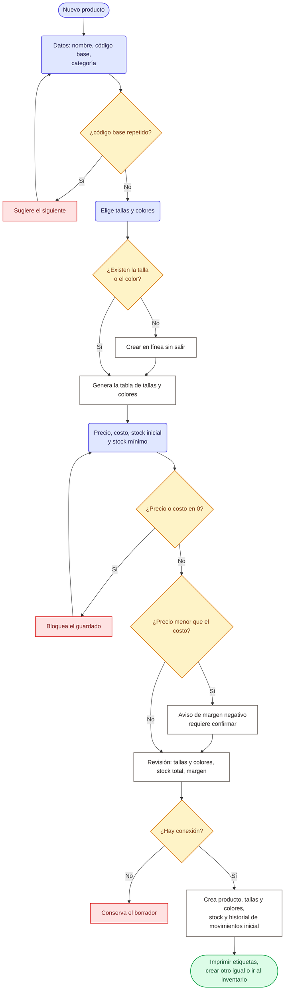

## C6 · Ajuste de stock

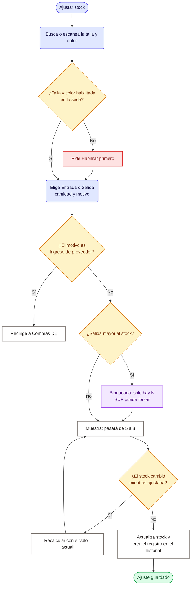

## C7 · Toma de inventario físico

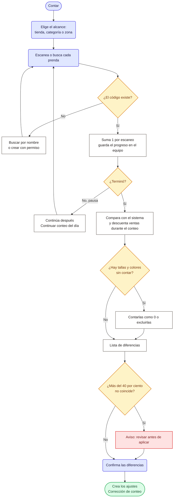

## C9 · Alertas de stock mínimo y reposición

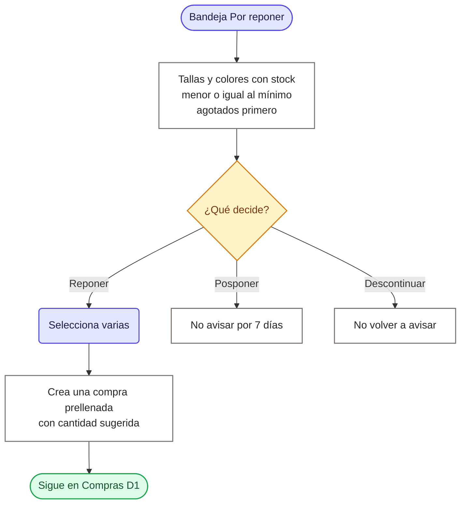

## D1 · Registrar una compra

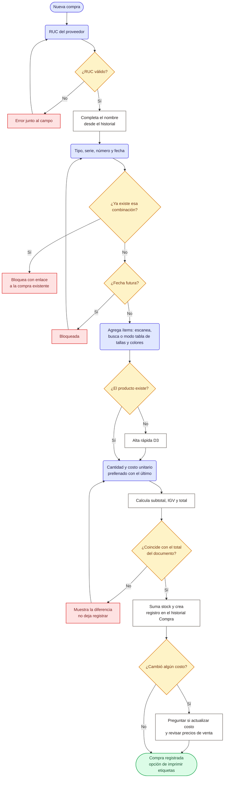

## D2 · Corregir o anular una compra

```mermaid
flowchart TD
  S(["Corregir compra"]):::persona --> A{"¿Mismo día y sin ventas<br/>de esa mercadería?"}:::decision
  A -->|"Sí"| B("Edita cantidades y costos"):::persona
  B --> C["Genera movimientos contrarios<br/>y nuevos"]:::sistema
  C --> OK1(["Compra corregida"]):::ok
  A -->|"No"| D["Muestra por talla y color:<br/>ingresaron N, ya se vendieron M"]:::sistema
  D --> E("Ajuste de salida<br/>solo por lo que queda"):::persona
  E --> F{"¿Dejaría stock negativo?"}:::decision
  F -->|"Sí"| F1["Bloquea esa talla y color"]:::error
  F -->|"No"| OK2(["Ajuste registrado con motivo"]):::ok
classDef persona fill:#e0e7ff,stroke:#4f46e5,color:#1e1b4b,stroke-width:1.5px;
classDef sistema fill:#ffffff,stroke:#78716c,color:#292524,stroke-width:1.5px;
classDef decision fill:#fef3c7,stroke:#d97706,color:#78350f,stroke-width:1.5px;
classDef error fill:#fee2e2,stroke:#dc2626,color:#7f1d1d,stroke-width:1.5px;
classDef ok fill:#dcfce7,stroke:#16a34a,color:#14532d,stroke-width:1.5px;
classDef pin fill:#f3e8ff,stroke:#9333ea,color:#581c87,stroke-width:1.5px;
```

## E1 · Consultar el historial de movimientos de una talla y color

```mermaid
flowchart TD
  S(["Historial de movimientos"]):::persona --> A("Elige la talla y color<br/>y los filtros"):::persona
  A --> B{"¿Tiene movimientos?"}:::decision
  B -->|"No"| B1["Aún no tiene movimientos"]:::error
  B -->|"Sí"| C["Línea de tiempo:<br/>fecha, tipo, documento,<br/>entrada, salida y saldo"]:::sistema
  C --> D{"¿El saldo del historial de movimientos<br/>es igual al stock actual?"}:::decision
  D -->|"Sí"| D1["Chip verde: coincide"]:::ok
  D -->|"No"| D2["Chip de alerta:<br/>diferencia de N unidades"]:::error
  D2 --> D3["Guía hacia un ajuste<br/>de corrección con motivo"]:::pin
  C --> E("Clic en un documento"):::persona
  E --> E1{"¿El documento se puede abrir?"}:::decision
  E1 -->|"Sí"| E2(["Abre la venta o la compra"]):::ok
  E1 -->|"No"| E3["Etiqueta Documento no disponible"]:::error
classDef persona fill:#e0e7ff,stroke:#4f46e5,color:#1e1b4b,stroke-width:1.5px;
classDef sistema fill:#ffffff,stroke:#78716c,color:#292524,stroke-width:1.5px;
classDef decision fill:#fef3c7,stroke:#d97706,color:#78350f,stroke-width:1.5px;
classDef error fill:#fee2e2,stroke:#dc2626,color:#7f1d1d,stroke-width:1.5px;
classDef ok fill:#dcfce7,stroke:#16a34a,color:#14532d,stroke-width:1.5px;
classDef pin fill:#f3e8ff,stroke:#9333ea,color:#581c87,stroke-width:1.5px;
```

## F2 · Registrar un cliente

```mermaid
flowchart TD
  S(["Nuevo cliente"]):::persona --> A("Elige tipo de documento<br/>y escribe el número"):::persona
  A --> B{"¿Formato válido?"}:::decision
  B -->|"No"| B1["Error junto al campo"]:::error
  B1 --> A
  B -->|"Sí"| C{"¿Ya existe el documento?"}:::decision
  C -->|"Sí"| C1["Ya está registrado:<br/>usar este cliente"]:::sistema
  C1 --> C2{"¿Pertenece a otra sede?"}:::decision
  C2 -->|"Sí"| C3["Aviso: registrado en otra sede<br/>se puede usar"]:::sistema
  C2 -->|"No"| OK0
  C3 --> OK0(["Cliente listo para la venta"]):::ok
  C -->|"No"| D("Pulsa Validar"):::persona
  D --> E{"¿El servicio responde?"}:::decision
  E -->|"No"| E1["Completar a mano<br/>marca Sin validar"]:::error
  E1 --> G
  E -->|"Sí"| F{"¿Encontró el documento?"}:::decision
  F -->|"No"| F1["Revisa el número<br/>o completa a mano"]:::error
  F1 --> G
  F -->|"Sí"| F2["Autocompleta nombre y dirección"]:::sistema
  F2 --> F3{"¿RUC de baja o no habido?"}:::decision
  F3 -->|"Sí"| F4["Aviso fuerte<br/>se desaconseja factura"]:::error
  F4 --> G
  F3 -->|"No"| G("Teléfono y correo opcionales"):::persona
  G --> H["Guarda el cliente"]:::sistema
  H --> OK0
classDef persona fill:#e0e7ff,stroke:#4f46e5,color:#1e1b4b,stroke-width:1.5px;
classDef sistema fill:#ffffff,stroke:#78716c,color:#292524,stroke-width:1.5px;
classDef decision fill:#fef3c7,stroke:#d97706,color:#78350f,stroke-width:1.5px;
classDef error fill:#fee2e2,stroke:#dc2626,color:#7f1d1d,stroke-width:1.5px;
classDef ok fill:#dcfce7,stroke:#16a34a,color:#14532d,stroke-width:1.5px;
classDef pin fill:#f3e8ff,stroke:#9333ea,color:#581c87,stroke-width:1.5px;
```

## G1 · Venta rápida en mostrador (flujo principal)

```mermaid
flowchart TD
  S(["Entra al punto de venta"]):::persona --> A{"¿La caja está abierta?"}:::decision
  A -->|"No"| A1["Lleva a Abrir caja B1"]:::error
  A -->|"Sí"| B("Agrega prendas G2<br/>escáner, búsqueda o grilla"):::persona
  B --> C["Carrito siempre visible con total G3"]:::sistema
  C --> D("Opcional: cliente y tipo<br/>de comprobante G4"):::persona
  D --> E("Opcional: descuento G3"):::persona
  E --> F("Pulsa Cobrar F9"):::persona
  F --> G("Elige el medio de pago<br/>y confirma G5"):::persona
  G --> H["Revalida stock y precios"]:::sistema
  H --> I{"¿Cambió algo?"}:::decision
  I -->|"Sí"| I1["Avisa y pide decidir"]:::error
  I1 --> C
  I -->|"No"| J["En una sola operación:<br/>reserva número, registra venta y pagos,<br/>descuenta stock y anota historial de movimientos"]:::sistema
  J --> K["Crea el comprobante y lo envía G6"]:::sistema
  K --> L{"¿Respuesta de SUNAT?"}:::decision
  L -->|"Aceptado"| L1(["Ticket: imprimir, WhatsApp o correo"]):::ok
  L -->|"Pendiente"| L2(["Venta registrada<br/>envío en segundo plano"]):::ok
  L -->|"Rechazado"| L3["Bandeja de errores H3"]:::error
  L1 --> Z(["Nueva venta<br/>el cursor vuelve al buscador"]):::ok
  L2 --> Z
classDef persona fill:#e0e7ff,stroke:#4f46e5,color:#1e1b4b,stroke-width:1.5px;
classDef sistema fill:#ffffff,stroke:#78716c,color:#292524,stroke-width:1.5px;
classDef decision fill:#fef3c7,stroke:#d97706,color:#78350f,stroke-width:1.5px;
classDef error fill:#fee2e2,stroke:#dc2626,color:#7f1d1d,stroke-width:1.5px;
classDef ok fill:#dcfce7,stroke:#16a34a,color:#14532d,stroke-width:1.5px;
classDef pin fill:#f3e8ff,stroke:#9333ea,color:#581c87,stroke-width:1.5px;
```

## G2 · Agregar productos

```mermaid
flowchart TD
  S(["Agregar prenda"]):::persona --> Q{"¿Cómo la busca?"}:::decision
  Q -->|"Escáner"| A("Lee el código y Enter"):::persona
  Q -->|"Búsqueda"| B("Nombre o código"):::persona
  Q -->|"Grilla o Packs"| C("Toca una tarjeta"):::persona
  A --> D{"¿El código existe?"}:::decision
  D -->|"No"| D1["No existe el código<br/>buscar por nombre"]:::error
  D -->|"Sí"| F
  B --> F
  C --> F{"¿El producto<br/>está activo?"}:::decision
  F -->|"No"| F1["Producto desactivado"]:::error
  F -->|"Sí"| G{"¿Tiene varias tallas y colores?"}:::decision
  G -->|"Sí"| G1["Selector en tabla de tallas y colores<br/>con el stock por celda"]:::sistema
  G1 --> H
  G -->|"No"| H{"¿Hay stock?"}:::decision
  H -->|"No"| H1["Agotado en esta sede"]:::error
  H1 --> H2{"¿La prenda está físicamente?"}:::decision
  H2 -->|"Sí"| H3["Vender sin stock:<br/>clave del supervisor y motivo"]:::pin
  H3 --> I
  H2 -->|"No"| H4["Ver otras sedes<br/>solo informativo"]:::sistema
  H -->|"Sí"| I{"¿La cantidad supera el stock?"}:::decision
  I -->|"Sí"| I1["Solo quedan N<br/>agrega lo disponible"]:::sistema
  I1 --> OK
  I -->|"No"| OK(["Agregado al carrito"]):::ok
classDef persona fill:#e0e7ff,stroke:#4f46e5,color:#1e1b4b,stroke-width:1.5px;
classDef sistema fill:#ffffff,stroke:#78716c,color:#292524,stroke-width:1.5px;
classDef decision fill:#fef3c7,stroke:#d97706,color:#78350f,stroke-width:1.5px;
classDef error fill:#fee2e2,stroke:#dc2626,color:#7f1d1d,stroke-width:1.5px;
classDef ok fill:#dcfce7,stroke:#16a34a,color:#14532d,stroke-width:1.5px;
classDef pin fill:#f3e8ff,stroke:#9333ea,color:#581c87,stroke-width:1.5px;
```

## G3 · Carrito, descuentos y packs

```mermaid
flowchart TD
  S(["Carrito"]):::persona --> Q{"¿Qué hace?"}:::decision
  Q -->|"Cambiar cantidad"| A{"¿Supera el stock?"}:::decision
  A -->|"Sí"| A1["Límite visible: solo quedan N"]:::error
  A -->|"No"| A2(["Cantidad actualizada"]):::ok
  Q -->|"Quitar prenda"| B["Se quita<br/>Deshacer por 6 segundos"]:::sistema
  Q -->|"Vaciar"| C["Pide confirmación"]:::sistema
  Q -->|"Cambiar precio de una línea"| D["clave del supervisor y motivo"]:::pin
  Q -->|"Aplicar descuento"| E{"¿Supera el límite del rol?"}:::decision
  E -->|"Sí"| E1["clave del supervisor o administrador"]:::pin
  E1 --> F
  E -->|"No"| F{"¿Es el 100 por ciento?"}:::decision
  F -->|"Sí"| F1["Bloqueado: la cortesía<br/>la registra SUP con motivo"]:::error
  F -->|"No"| G["Recalcula<br/>Subtotal, Descuento y Total"]:::sistema
  G --> H{"¿Hay packs en el carrito?"}:::decision
  H -->|"Sí"| H1["El descuento no se acumula<br/>con el precio del pack"]:::sistema
  H1 --> OK
  H -->|"No"| OK(["Total a cobrar actualizado<br/>incluye IGV"]):::ok
classDef persona fill:#e0e7ff,stroke:#4f46e5,color:#1e1b4b,stroke-width:1.5px;
classDef sistema fill:#ffffff,stroke:#78716c,color:#292524,stroke-width:1.5px;
classDef decision fill:#fef3c7,stroke:#d97706,color:#78350f,stroke-width:1.5px;
classDef error fill:#fee2e2,stroke:#dc2626,color:#7f1d1d,stroke-width:1.5px;
classDef ok fill:#dcfce7,stroke:#16a34a,color:#14532d,stroke-width:1.5px;
classDef pin fill:#f3e8ff,stroke:#9333ea,color:#581c87,stroke-width:1.5px;
```

## G4 · Cliente y tipo de comprobante

```mermaid
flowchart TD
  S(["¿Boleta o factura?"]):::decision
  S -->|"Boleta"| A{"¿El monto exige identificar<br/>al comprador?"}:::decision
  A -->|"No"| A1(["Clientes varios<br/>o cliente opcional"]):::ok
  A -->|"Sí"| A2("Pide el documento<br/>antes de cobrar"):::persona
  A2 --> OK2(["Boleta con cliente identificado"]):::ok
  S -->|"Factura"| B("Busca el cliente por RUC"):::persona
  B --> C{"¿Tiene RUC?"}:::decision
  C -->|"No"| C1["Factura necesita un RUC:<br/>buscar otra empresa o cambiar a boleta"]:::error
  C -->|"Sí"| D{"¿El RUC está habido?"}:::decision
  D -->|"No"| D1["Aviso: figura como no habido<br/>¿continuar?"]:::error
  D1 --> E
  D -->|"Sí"| E{"¿Responde la validación?"}:::decision
  E -->|"No"| E1["Continúa con RUC marcado Sin validar"]:::sistema
  E1 --> OK
  E -->|"Sí"| OK(["Factura lista para cobrar"]):::ok
  Z(["La clienta pide factura<br/>después de pagar"]):::persona -.-> Y["No se edita:<br/>ver anulación H5"]:::error
classDef persona fill:#e0e7ff,stroke:#4f46e5,color:#1e1b4b,stroke-width:1.5px;
classDef sistema fill:#ffffff,stroke:#78716c,color:#292524,stroke-width:1.5px;
classDef decision fill:#fef3c7,stroke:#d97706,color:#78350f,stroke-width:1.5px;
classDef error fill:#fee2e2,stroke:#dc2626,color:#7f1d1d,stroke-width:1.5px;
classDef ok fill:#dcfce7,stroke:#16a34a,color:#14532d,stroke-width:1.5px;
classDef pin fill:#f3e8ff,stroke:#9333ea,color:#581c87,stroke-width:1.5px;
```

## G5 · Cobro (incluye pago mixto)

```mermaid
flowchart TD
  S(["Pulsa Cobrar"]):::persona --> A{"¿Hay medios de pago activos?"}:::decision
  A -->|"No"| A1["Avisa a tu administrador"]:::error
  A -->|"Sí"| B("Elige el medio de pago"):::persona
  B --> Q{"¿Qué medio?"}:::decision
  Q -->|"Efectivo"| E("Monto recibido<br/>Exacto o billetes sugeridos"):::persona
  E --> E1{"¿Cubre el total?"}:::decision
  E1 -->|"No"| E2["Faltan S/ X<br/>Confirmar bloqueado"]:::error
  E1 -->|"Sí"| E3{"¿Hay efectivo en caja<br/>para el vuelto?"}:::decision
  E3 -->|"No"| E4["Pide un billete menor<br/>o cobrar por otro medio"]:::error
  E3 -->|"Sí"| V["Muestra el vuelto grande"]:::sistema
  Q -->|"Digital"| D("Instrucciones del medio<br/>y N° de operación"):::persona
  D --> D1{"¿El número ya se usó?"}:::decision
  D1 -->|"Sí"| D2["Aviso con el comprobante anterior"]:::error
  D1 -->|"No"| D3{"¿Llegó la notificación?"}:::decision
  D3 -->|"No"| D4["Esperar o cambiar de medio"]:::sistema
  D3 -->|"Sí"| M
  Q -->|"Tarjeta"| T("Referencia del voucher"):::persona
  T --> T1{"¿Fue rechazada?"}:::decision
  T1 -->|"Sí"| T2["Otra tarjeta o cambiar de medio<br/>sin perder lo ingresado"]:::error
  T1 -->|"No"| M
  V --> M{"¿Quiere agregar<br/>otro medio?"}:::decision
  M -->|"Sí"| M1["Pago mixto: prellena el resto<br/>máximo 3 medios"]:::sistema
  M1 --> B
  M -->|"No"| N{"¿La suma cubre el total?"}:::decision
  N -->|"No"| N1["Falta un monto"]:::error
  N -->|"Sí"| OK(["Confirmar<br/>el botón se bloquea contra doble clic"]):::ok
classDef persona fill:#e0e7ff,stroke:#4f46e5,color:#1e1b4b,stroke-width:1.5px;
classDef sistema fill:#ffffff,stroke:#78716c,color:#292524,stroke-width:1.5px;
classDef decision fill:#fef3c7,stroke:#d97706,color:#78350f,stroke-width:1.5px;
classDef error fill:#fee2e2,stroke:#dc2626,color:#7f1d1d,stroke-width:1.5px;
classDef ok fill:#dcfce7,stroke:#16a34a,color:#14532d,stroke-width:1.5px;
classDef pin fill:#f3e8ff,stroke:#9333ea,color:#581c87,stroke-width:1.5px;
```

## G6 · Emisión y post-venta

```mermaid
flowchart TD
  S(["Confirma el cobro"]):::persona --> A["Barra de progreso:<br/>Firmando, Enviando, Listo"]:::sistema
  A --> B{"¿Resultado?"}:::decision
  B -->|"Aceptado"| C(["Pantalla de éxito:<br/>número, total y vuelto grande"]):::ok
  B -->|"Tarda más de 10 s"| D(["Venta registrada<br/>se envía en segundo plano"]):::ok
  B -->|"Rechazado"| E["Aviso: no fue aceptado<br/>ver motivo en la bandeja H3"]:::error
  B -->|"Sin conexión"| F["Modo sin conexión H6"]:::error
  C --> G{"¿Qué elige?"}:::decision
  D --> G
  G -->|"Imprimir"| H{"¿Imprime?"}:::decision
  H -->|"No"| H1["Reintentar, ver PDF<br/>o enviar por WhatsApp"]:::error
  H -->|"Sí"| OK
  G -->|"WhatsApp"| W{"¿Tiene teléfono<br/>y el PDF está listo?"}:::decision
  W -->|"No"| W1["Pide el número o espera Generando"]:::sistema
  W1 --> OK
  W -->|"Sí"| OK
  G -->|"Correo"| OK
  OK(["Nueva venta"]):::ok
classDef persona fill:#e0e7ff,stroke:#4f46e5,color:#1e1b4b,stroke-width:1.5px;
classDef sistema fill:#ffffff,stroke:#78716c,color:#292524,stroke-width:1.5px;
classDef decision fill:#fef3c7,stroke:#d97706,color:#78350f,stroke-width:1.5px;
classDef error fill:#fee2e2,stroke:#dc2626,color:#7f1d1d,stroke-width:1.5px;
classDef ok fill:#dcfce7,stroke:#16a34a,color:#14532d,stroke-width:1.5px;
classDef pin fill:#f3e8ff,stroke:#9333ea,color:#581c87,stroke-width:1.5px;
```

## G7 · Venta en espera

```mermaid
flowchart TD
  S(["Pulsa En espera F4"]):::persona --> A{"¿Ya hay 5 en espera?"}:::decision
  A -->|"Sí"| A1["Límite alcanzado:<br/>cobrar o descartar una"]:::error
  A -->|"No"| B["Guarda el carrito con hora y cliente"]:::sistema
  B --> C("Atiende a otra persona"):::persona
  C --> D("Abre Ventas en espera<br/>y elige una"):::persona
  D --> E["Revalida stock y precios"]:::sistema
  E --> F{"¿Alguna prenda<br/>ya no está disponible?"}:::decision
  F -->|"Sí"| F1["Marca Ya no disponible"]:::error
  F1 --> OK
  F -->|"No"| OK(["Continúa la venta"]):::ok
  X(["El cliente se fue"]):::persona -.-> Y["Descartar con confirmación"]:::sistema
  Z(["Cierre de caja con esperas"]):::persona -.-> W["Bloqueado hasta resolverlas B3"]:::error
classDef persona fill:#e0e7ff,stroke:#4f46e5,color:#1e1b4b,stroke-width:1.5px;
classDef sistema fill:#ffffff,stroke:#78716c,color:#292524,stroke-width:1.5px;
classDef decision fill:#fef3c7,stroke:#d97706,color:#78350f,stroke-width:1.5px;
classDef error fill:#fee2e2,stroke:#dc2626,color:#7f1d1d,stroke-width:1.5px;
classDef ok fill:#dcfce7,stroke:#16a34a,color:#14532d,stroke-width:1.5px;
classDef pin fill:#f3e8ff,stroke:#9333ea,color:#581c87,stroke-width:1.5px;
```

## G8 · Falla de red al confirmar (respuesta incierta)

```mermaid
flowchart TD
  S(["Confirma el cobro"]):::persona --> A{"¿Llegó la respuesta?"}:::decision
  A -->|"Sí"| OK(["Flujo normal G6"]):::ok
  A -->|"No, se cayó la red"| B["Consulta la última venta<br/>antes de permitir reintentar"]:::sistema
  B --> C{"¿Se guardó la venta?"}:::decision
  C -->|"Sí"| D(["Va a la pantalla de éxito<br/>sin duplicar"]):::ok
  C -->|"No"| E["No se registró la venta<br/>el cliente no ha pagado en el sistema"]:::error
  E --> F{"¿Ya se cobró en efectivo?"}:::decision
  F -->|"Sí"| G["Guía: no entregues la prenda<br/>reintenta o devuelve el efectivo"]:::error
  G --> H
  F -->|"No"| H("Reintentar"):::persona
  H --> A
classDef persona fill:#e0e7ff,stroke:#4f46e5,color:#1e1b4b,stroke-width:1.5px;
classDef sistema fill:#ffffff,stroke:#78716c,color:#292524,stroke-width:1.5px;
classDef decision fill:#fef3c7,stroke:#d97706,color:#78350f,stroke-width:1.5px;
classDef error fill:#fee2e2,stroke:#dc2626,color:#7f1d1d,stroke-width:1.5px;
classDef ok fill:#dcfce7,stroke:#16a34a,color:#14532d,stroke-width:1.5px;
classDef pin fill:#f3e8ff,stroke:#9333ea,color:#581c87,stroke-width:1.5px;
```

## H2 · Bandeja de pendientes y errores

```mermaid
flowchart TD
  S(["Bandeja de comprobantes"]):::persona --> A["Lista con estado, cliente,<br/>total y días transcurridos"]:::sistema
  A --> B{"¿Se acerca el plazo<br/>de envío?"}:::decision
  B -->|"Sí"| B1["Se resalta en rojo"]:::error
  B -->|"No"| C
  B1 --> C("Reenviar uno<br/>o todos los pendientes"):::persona
  C --> D["Progreso y resultado por fila"]:::sistema
  D --> E{"¿Fue aceptado?"}:::decision
  E -->|"Sí"| OK(["Sale de la bandeja"]):::ok
  E -->|"No"| F["Conserva el motivo más reciente"]:::error
  F --> G{"¿Rechazado?"}:::decision
  G -->|"Sí"| G1["Corregir y reenviar H3"]:::sistema
  G -->|"No"| G2["Sigue en reintento automático<br/>Último intento hace N min"]:::sistema
classDef persona fill:#e0e7ff,stroke:#4f46e5,color:#1e1b4b,stroke-width:1.5px;
classDef sistema fill:#ffffff,stroke:#78716c,color:#292524,stroke-width:1.5px;
classDef decision fill:#fef3c7,stroke:#d97706,color:#78350f,stroke-width:1.5px;
classDef error fill:#fee2e2,stroke:#dc2626,color:#7f1d1d,stroke-width:1.5px;
classDef ok fill:#dcfce7,stroke:#16a34a,color:#14532d,stroke-width:1.5px;
classDef pin fill:#f3e8ff,stroke:#9333ea,color:#581c87,stroke-width:1.5px;
```

## H3 · Comprobante rechazado u observado

```mermaid
flowchart TD
  S(["Abre un comprobante<br/>No aceptado"]):::persona --> A["Muestra el motivo<br/>en lenguaje claro"]:::sistema
  A --> B{"¿Se puede corregir<br/>en pantalla?"}:::decision
  B -->|"Sí"| C("Corrige solo lo permitido,<br/>ejemplo datos del cliente"):::persona
  C --> D["Reenvía con el mismo número"]:::sistema
  D --> E{"¿Fue aceptado?"}:::decision
  E -->|"Sí"| OK(["Comprobante aceptado"]):::ok
  E -->|"No"| F["Muestra el nuevo motivo"]:::error
  F --> B
  B -->|"No, es el monto"| G["Anular y reemitir H5"]:::pin
  S2(["Observado"]):::persona -.-> O["Aviso para revisar,<br/>sin reenviar"]:::sistema
classDef persona fill:#e0e7ff,stroke:#4f46e5,color:#1e1b4b,stroke-width:1.5px;
classDef sistema fill:#ffffff,stroke:#78716c,color:#292524,stroke-width:1.5px;
classDef decision fill:#fef3c7,stroke:#d97706,color:#78350f,stroke-width:1.5px;
classDef error fill:#fee2e2,stroke:#dc2626,color:#7f1d1d,stroke-width:1.5px;
classDef ok fill:#dcfce7,stroke:#16a34a,color:#14532d,stroke-width:1.5px;
classDef pin fill:#f3e8ff,stroke:#9333ea,color:#581c87,stroke-width:1.5px;
```

## H5 · Anular o emitir nota de crédito (asistente)

```mermaid
flowchart TD
  S(["Elige el comprobante"]):::persona --> A{"¿Estado del comprobante?"}:::decision
  A -->|"Ya anulado o con nota"| A1["Bloqueado con el estado actual"]:::error
  A -->|"Pendiente"| A2["Primero debe aceptarse o corregirse"]:::error
  A -->|"Aceptado"| B{"¿Hay conexión?"}:::decision
  B -->|"No"| B1["Necesitas conexión"]:::error
  B -->|"Sí"| Q{"¿Qué pasó?"}:::decision
  Q -->|"Devolvió todo"| I1(["Devolución total I1"]):::ok
  Q -->|"Devolvió una parte"| I2(["Devolución parcial I2"]):::ok
  Q -->|"Se cambió de prenda"| I3(["Cambio I3"]):::ok
  Q -->|"Error en datos del cliente"| N1["Nota de crédito de corrección<br/>y nueva emisión"]:::sistema
  Q -->|"Error en monto o prendas"| N2["Anular y emitir de nuevo"]:::sistema
  Q -->|"Pidió factura después<br/>de la boleta"| F1["Anula la boleta"]:::sistema
  F1 --> F2["Crea venta nueva<br/>con las mismas prendas"]:::sistema
  F2 --> F3("Elige el cliente con RUC"):::persona
  F3 --> F4["Traslada el pago sin mover dinero<br/>y emite la factura"]:::sistema
  N1 --> M("Motivo obligatorio"):::persona
  N2 --> M
  M --> P["clave del supervisor"]:::pin
  P --> R["Resumen del efecto:<br/>stock, caja y comprobante"]:::sistema
  R --> T{"¿La venta es de un turno cerrado?"}:::decision
  T -->|"Sí"| T1["El reembolso cae en la sesión actual"]:::sistema
  T1 --> U
  T -->|"No"| U{"¿Hay efectivo para reembolsar?"}:::decision
  U -->|"No"| U1["Otro medio o esperar"]:::error
  U -->|"Sí"| OK(["Se actualizan comprobante,<br/>venta, historial de movimientos y caja"]):::ok
classDef persona fill:#e0e7ff,stroke:#4f46e5,color:#1e1b4b,stroke-width:1.5px;
classDef sistema fill:#ffffff,stroke:#78716c,color:#292524,stroke-width:1.5px;
classDef decision fill:#fef3c7,stroke:#d97706,color:#78350f,stroke-width:1.5px;
classDef error fill:#fee2e2,stroke:#dc2626,color:#7f1d1d,stroke-width:1.5px;
classDef ok fill:#dcfce7,stroke:#16a34a,color:#14532d,stroke-width:1.5px;
classDef pin fill:#f3e8ff,stroke:#9333ea,color:#581c87,stroke-width:1.5px;
```

## H6 · Modo sin conexión (SUNAT caído o sin internet)

```mermaid
flowchart TD
  S(["Se detecta una falla"]):::persona --> A{"¿Qué falla?"}:::decision
  A -->|"SUNAT no responde<br/>el sistema sí"| B["Aviso ámbar:<br/>sigues vendiendo"]:::sistema
  B --> B1["Los comprobantes quedan En proceso"]:::sistema
  B1 --> B2(["Reenvío automático al volver"]):::ok
  A -->|"Sin internet"| C["Aviso rojo"]:::error
  C --> D{"¿El negocio habilitó<br/>el modo local?"}:::decision
  D -->|"No"| D1["Bloquea las ventas<br/>hasta reconectar"]:::error
  D -->|"Sí"| E["Vende con límite:<br/>hasta 20 ventas o 2 horas"]:::sistema
  E --> F["Aviso: el stock puede<br/>no estar actualizado"]:::sistema
  F --> G["Al reconectar: sincroniza<br/>18 enviadas, 2 con problemas"]:::sistema
  G --> H{"¿Quedó stock negativo?"}:::decision
  H -->|"Sí"| H1["Lista para que SUP regularice"]:::pin
  H -->|"No"| OK(["Todo sincronizado"]):::ok
classDef persona fill:#e0e7ff,stroke:#4f46e5,color:#1e1b4b,stroke-width:1.5px;
classDef sistema fill:#ffffff,stroke:#78716c,color:#292524,stroke-width:1.5px;
classDef decision fill:#fef3c7,stroke:#d97706,color:#78350f,stroke-width:1.5px;
classDef error fill:#fee2e2,stroke:#dc2626,color:#7f1d1d,stroke-width:1.5px;
classDef ok fill:#dcfce7,stroke:#16a34a,color:#14532d,stroke-width:1.5px;
classDef pin fill:#f3e8ff,stroke:#9333ea,color:#581c87,stroke-width:1.5px;
```

## I1 · Devolución con comprobante

```mermaid
flowchart TD
  S(["Devoluciones"]):::persona --> A("Busca la venta:<br/>número, QR, documento o fecha"):::persona
  A --> B{"¿La encontró?"}:::decision
  B -->|"No"| B1["Buscar por cliente,<br/>fecha y monto"]:::sistema
  B1 --> A
  B -->|"Sí"| C["Muestra líneas, pagos<br/>y días transcurridos"]:::sistema
  C --> D{"¿Dentro del plazo?"}:::decision
  D -->|"No"| D1["Solo SUP con motivo"]:::pin
  D1 --> E
  D -->|"Sí"| E("Elige líneas y cantidades<br/>y el motivo"):::persona
  E --> F{"¿Cantidad mayor<br/>a la comprada o ya devuelta?"}:::decision
  F -->|"Sí"| F1["No se permite"]:::error
  F1 --> E
  F -->|"No"| G("Condición de cada prenda:<br/>reingresa, dañada o en revisión"):::persona
  G --> H["Calcula el monto con el descuento repartido"]:::sistema
  H --> I("Elige el medio de reembolso"):::persona
  I --> J{"¿Reembolso en efectivo<br/>mayor al efectivo de caja?"}:::decision
  J -->|"Sí"| J1["Elegir otro medio"]:::error
  J1 --> I
  J -->|"No"| K["clave del supervisor si corresponde"]:::pin
  K --> L["Emite la nota de crédito,<br/>mueve el stock, registra caja<br/>y actualiza la venta"]:::sistema
  L --> OK(["Imprime la nota<br/>y el comprobante de devolución"]):::ok
classDef persona fill:#e0e7ff,stroke:#4f46e5,color:#1e1b4b,stroke-width:1.5px;
classDef sistema fill:#ffffff,stroke:#78716c,color:#292524,stroke-width:1.5px;
classDef decision fill:#fef3c7,stroke:#d97706,color:#78350f,stroke-width:1.5px;
classDef error fill:#fee2e2,stroke:#dc2626,color:#7f1d1d,stroke-width:1.5px;
classDef ok fill:#dcfce7,stroke:#16a34a,color:#14532d,stroke-width:1.5px;
classDef pin fill:#f3e8ff,stroke:#9333ea,color:#581c87,stroke-width:1.5px;
```

## I3 · Cambio de talla o color

```mermaid
flowchart TD
  S(["Busca la venta y pulsa<br/>Cambiar en la prenda"]):::persona --> A{"¿Dentro del plazo?"}:::decision
  A -->|"No"| A1["Solo SUP"]:::pin
  A1 --> B
  A -->|"Sí"| B("Elige la prenda nueva<br/>escanea o busca"):::persona
  B --> C["Muestra stock por talla y color"]:::sistema
  C --> D{"¿Hay stock de la nueva?"}:::decision
  D -->|"No"| D1["Otras tallas y colores, otras sedes<br/>o convertir en devolución simple"]:::sistema
  D1 --> B
  D -->|"Sí"| E{"¿El precio actual<br/>de la original bajó?"}:::decision
  E -->|"Sí"| E1["Se cambia por el valor pagado<br/>con aviso"]:::sistema
  E1 --> F
  E -->|"No"| F["Calcula la diferencia"]:::sistema
  F --> G{"¿Diferencia?"}:::decision
  G -->|"Mismo precio"| H
  G -->|"Debe pagar"| G1("Cobra la diferencia G5"):::persona
  G1 --> H
  G -->|"Se devuelve"| G2{"¿Hay efectivo u otro medio?"}:::decision
  G2 -->|"No"| G3["Elegir otra prenda para igualar"]:::error
  G2 -->|"Sí"| H
  H["clave del supervisor si aplica"]:::pin
  H --> I["Por debajo: devuelve la original,<br/>crea la venta nueva,<br/>ajusta stock y caja"]:::sistema
  I --> OK(["Imprime los comprobantes"]):::ok
classDef persona fill:#e0e7ff,stroke:#4f46e5,color:#1e1b4b,stroke-width:1.5px;
classDef sistema fill:#ffffff,stroke:#78716c,color:#292524,stroke-width:1.5px;
classDef decision fill:#fef3c7,stroke:#d97706,color:#78350f,stroke-width:1.5px;
classDef error fill:#fee2e2,stroke:#dc2626,color:#7f1d1d,stroke-width:1.5px;
classDef ok fill:#dcfce7,stroke:#16a34a,color:#14532d,stroke-width:1.5px;
classDef pin fill:#f3e8ff,stroke:#9333ea,color:#581c87,stroke-width:1.5px;
```

## I4 · Devolución o cambio sin comprobante

```mermaid
flowchart TD
  S(["Clienta sin ticket"]):::persona --> A{"¿La compra está en el sistema?"}:::decision
  A -->|"Sí, se encuentra"| A1(["Sigue como I1 o I3"]):::ok
  A -->|"No"| B["Solo SUP o ADM"]:::pin
  B --> C("Pide documento de la clienta,<br/>motivo y condición de la prenda"):::persona
  C --> D{"¿Qué quiere?"}:::decision
  D -->|"Reembolso en dinero"| D1["No permitido sin comprobante"]:::error
  D -->|"Cambio por otra prenda"| E{"¿De igual o menor valor?"}:::decision
  E -->|"No"| E1["No hay diferencia a favor:<br/>elegir otra prenda"]:::error
  E1 --> D
  E -->|"Sí"| F["Registra el movimiento de stock con nota"]:::sistema
  F --> OK(["Cambio hecho y anotado"]):::ok
classDef persona fill:#e0e7ff,stroke:#4f46e5,color:#1e1b4b,stroke-width:1.5px;
classDef sistema fill:#ffffff,stroke:#78716c,color:#292524,stroke-width:1.5px;
classDef decision fill:#fef3c7,stroke:#d97706,color:#78350f,stroke-width:1.5px;
classDef error fill:#fee2e2,stroke:#dc2626,color:#7f1d1d,stroke-width:1.5px;
classDef ok fill:#dcfce7,stroke:#16a34a,color:#14532d,stroke-width:1.5px;
classDef pin fill:#f3e8ff,stroke:#9333ea,color:#581c87,stroke-width:1.5px;
```

## J1 · Crear una venta con envío

```mermaid
flowchart TD
  S(["Activa Envío en el carrito"]):::persona --> A("Elige o registra al cliente"):::persona
  A --> B{"¿Tiene teléfono?"}:::decision
  B -->|"No"| B1["Obligatorio: pide el número"]:::error
  B1 --> C
  B -->|"Sí"| C("Dirección, referencia y distrito"):::persona
  C --> D{"¿Dirección completa?"}:::decision
  D -->|"No"| D1["Indica qué falta"]:::error
  D1 --> C
  D -->|"Sí"| E("Costo de envío o Envío gratis"):::persona
  E --> F{"¿Costo vacío?"}:::decision
  F -->|"Sí"| F1["¿El envío es gratis?"]:::sistema
  F1 --> G
  F -->|"No"| G("Courier y fecha estimada"):::persona
  G --> H{"¿Fecha en domingo<br/>o feriado?"}:::decision
  H -->|"Sí"| H1["Aviso, no bloquea"]:::sistema
  H1 --> I
  H -->|"No"| I["Resumen:<br/>Productos + Envío = Total a cobrar"]:::sistema
  I --> J{"¿Pagar ahora<br/>o contra entrega?"}:::decision
  J -->|"Ahora"| K("Cobra G5"):::persona
  J -->|"Contra entrega"| L["Venta en pago pendiente J8"]:::sistema
  K --> OK(["Crea la venta y el envío<br/>en el estado inicial"]):::ok
  L --> OK
classDef persona fill:#e0e7ff,stroke:#4f46e5,color:#1e1b4b,stroke-width:1.5px;
classDef sistema fill:#ffffff,stroke:#78716c,color:#292524,stroke-width:1.5px;
classDef decision fill:#fef3c7,stroke:#d97706,color:#78350f,stroke-width:1.5px;
classDef error fill:#fee2e2,stroke:#dc2626,color:#7f1d1d,stroke-width:1.5px;
classDef ok fill:#dcfce7,stroke:#16a34a,color:#14532d,stroke-width:1.5px;
classDef pin fill:#f3e8ff,stroke:#9333ea,color:#581c87,stroke-width:1.5px;
```

## J2 · Estados y avance del pedido

```mermaid
flowchart TD
  S(["Abre el pedido"]):::persona --> Q{"¿Qué hace?"}:::decision
  Q -->|"Avanzar al siguiente estado"| A{"¿Pasa a En camino<br/>sin courier ni guía?"}:::decision
  A -->|"Sí"| A1["Pide courier y guía antes"]:::error
  A1 --> B
  A -->|"No"| B["Cambia el estado y guarda<br/>persona, hora y observación"]:::sistema
  B --> C{"¿Es un estado clave?"}:::decision
  C -->|"Sí"| C1["Ofrece mensaje de WhatsApp<br/>ya redactado para revisar"]:::sistema
  C1 --> OK
  C -->|"No"| OK(["Pedido actualizado"]):::ok
  Q -->|"Retroceder o saltar"| D["Motivo y clave del supervisor"]:::pin
  D --> B
  Q -->|"Deshacer un cambio"| E{"¿Pasaron menos de 10 min?"}:::decision
  E -->|"Sí"| E1["Deshace con motivo<br/>queda en el historial"]:::sistema
  E -->|"No"| E2["Solo con clave del supervisor"]:::pin
  X(["Dos personas cambian a la vez"]):::persona -.-> Y["La segunda ve:<br/>ya está En camino, actualizar"]:::error
classDef persona fill:#e0e7ff,stroke:#4f46e5,color:#1e1b4b,stroke-width:1.5px;
classDef sistema fill:#ffffff,stroke:#78716c,color:#292524,stroke-width:1.5px;
classDef decision fill:#fef3c7,stroke:#d97706,color:#78350f,stroke-width:1.5px;
classDef error fill:#fee2e2,stroke:#dc2626,color:#7f1d1d,stroke-width:1.5px;
classDef ok fill:#dcfce7,stroke:#16a34a,color:#14532d,stroke-width:1.5px;
classDef pin fill:#f3e8ff,stroke:#9333ea,color:#581c87,stroke-width:1.5px;
```

## J3 · Preparar, asignar courier y guía

```mermaid
flowchart TD
  S(["Abre el pedido en Preparando"]):::persona --> A["Checklist con las prendas del pedido"]:::sistema
  A --> B("Escanea cada prenda"):::persona
  B --> C{"¿Es una prenda del pedido?"}:::decision
  C -->|"No"| C1["Alerta: no pertenece al pedido"]:::error
  C1 --> B
  C -->|"Sí"| D{"¿Falta alguna prenda?"}:::decision
  D -->|"Sí"| D1["Cambiar prenda I3<br/>o quitar del pedido"]:::sistema
  D1 --> E
  D -->|"No"| E["Pasa a Listo para envío"]:::sistema
  E --> F["Imprime etiqueta y hoja de pedido"]:::sistema
  F --> G("Asigna courier y número de guía"):::persona
  G --> H{"¿La guía ya se usó<br/>en otro pedido?"}:::decision
  H -->|"Sí"| H1["Aviso con el pedido original"]:::error
  H1 --> G
  H -->|"No"| OK(["Marca En camino<br/>y notifica al cliente"]):::ok
classDef persona fill:#e0e7ff,stroke:#4f46e5,color:#1e1b4b,stroke-width:1.5px;
classDef sistema fill:#ffffff,stroke:#78716c,color:#292524,stroke-width:1.5px;
classDef decision fill:#fef3c7,stroke:#d97706,color:#78350f,stroke-width:1.5px;
classDef error fill:#fee2e2,stroke:#dc2626,color:#7f1d1d,stroke-width:1.5px;
classDef ok fill:#dcfce7,stroke:#16a34a,color:#14532d,stroke-width:1.5px;
classDef pin fill:#f3e8ff,stroke:#9333ea,color:#581c87,stroke-width:1.5px;
```

## J5 · Entrega fallida y reprogramación

```mermaid
flowchart TD
  S(["Marca Fallido y elige el motivo"]):::persona --> A["Guarda el intento en el historial"]:::sistema
  A --> B{"¿Cuántos intentos fallidos?"}:::decision
  B -->|"Dos o más"| B1["Sugiere devolver a tienda"]:::sistema
  B1 --> C
  B -->|"Uno"| C{"¿Qué decide?"}:::decision
  C -->|"Reprogramar"| D("Nueva fecha y,<br/>si hace falta, edita la dirección"):::persona
  D --> E["Notifica al cliente<br/>y anota el costo extra"]:::sistema
  E --> OK1(["Vuelve a En camino"]):::ok
  C -->|"Devolver a tienda"| F["Estado Devuelto a tienda"]:::sistema
  F --> G{"¿Reponer o devolver el dinero?"}:::decision
  G -->|"Reponer"| OK2(["La prenda vuelve al stock"]):::ok
  G -->|"Devolver"| OK3(["Devolución I1"]):::ok
  X(["El cliente no responde en 3 días"]):::persona -.-> Y["Aviso a SUP y opción de cancelar J6"]:::error
classDef persona fill:#e0e7ff,stroke:#4f46e5,color:#1e1b4b,stroke-width:1.5px;
classDef sistema fill:#ffffff,stroke:#78716c,color:#292524,stroke-width:1.5px;
classDef decision fill:#fef3c7,stroke:#d97706,color:#78350f,stroke-width:1.5px;
classDef error fill:#fee2e2,stroke:#dc2626,color:#7f1d1d,stroke-width:1.5px;
classDef ok fill:#dcfce7,stroke:#16a34a,color:#14532d,stroke-width:1.5px;
classDef pin fill:#f3e8ff,stroke:#9333ea,color:#581c87,stroke-width:1.5px;
```

## J6 · Cancelar un pedido

```mermaid
flowchart TD
  S(["Cancelar pedido"]):::persona --> A("Motivo obligatorio"):::persona
  A --> B{"¿En qué estado está?"}:::decision
  B -->|"Antes de preparar<br/>o preparando"| C{"¿Está pagado?"}:::decision
  C -->|"Sí"| C1["clave del supervisor"]:::pin
  C1 --> D
  C -->|"No"| D["Cancela y el stock vuelve"]:::sistema
  D --> E["Anula o emite nota de crédito<br/>y reembolsa H5 I5"]:::sistema
  E --> OK1(["Pedido cancelado"]):::ok
  B -->|"En camino"| F["No se cancela:<br/>se espera el retorno"]:::error
  F --> G["Marca Devuelto a tienda<br/>al regresar"]:::sistema
  G --> E
  B -->|"Entregado"| H(["Es una devolución I1"]):::ok
  X(["El courier perdió el paquete"]):::persona -.-> Y["Estado Extraviado<br/>nota de crédito o reposición"]:::pin
classDef persona fill:#e0e7ff,stroke:#4f46e5,color:#1e1b4b,stroke-width:1.5px;
classDef sistema fill:#ffffff,stroke:#78716c,color:#292524,stroke-width:1.5px;
classDef decision fill:#fef3c7,stroke:#d97706,color:#78350f,stroke-width:1.5px;
classDef error fill:#fee2e2,stroke:#dc2626,color:#7f1d1d,stroke-width:1.5px;
classDef ok fill:#dcfce7,stroke:#16a34a,color:#14532d,stroke-width:1.5px;
classDef pin fill:#f3e8ff,stroke:#9333ea,color:#581c87,stroke-width:1.5px;
```

## J8 · Pago contra entrega

```mermaid
flowchart TD
  S(["Crea pedido Contra entrega"]):::persona --> A{"¿Supera el límite<br/>o la zona no aplica?"}:::decision
  A -->|"Sí"| A1["No disponible:<br/>pagar ahora"]:::error
  A -->|"No"| B["Venta en pago pendiente<br/>no entra dinero a la caja"]:::sistema
  B --> C["El repartidor entrega"]:::sistema
  C --> D{"¿El cliente acepta<br/>y paga?"}:::decision
  D -->|"Rechaza"| D1["Entrega fallida J5<br/>o cancelación J6"]:::error
  D -->|"Paga una parte"| D2["Pago mixto G5"]:::sistema
  D2 --> E
  D -->|"Paga todo"| E("El repartidor rinde<br/>el dinero a caja"):::persona
  E --> F{"¿Rinde el mismo día?"}:::decision
  F -->|"No"| F1["Aparece como Efectivo por rendir<br/>y en el cierre de caja"]:::error
  F1 --> G
  F -->|"Sí"| G("Registra el pago con el medio"):::persona
  G --> H{"¿Rindió menos de lo cobrado?"}:::decision
  H -->|"Sí"| H1["Diferencia con observación<br/>y aviso a SUP"]:::pin
  H1 --> OK
  H -->|"No"| OK(["Venta completada<br/>el efectivo entra a la caja que recibe"]):::ok
classDef persona fill:#e0e7ff,stroke:#4f46e5,color:#1e1b4b,stroke-width:1.5px;
classDef sistema fill:#ffffff,stroke:#78716c,color:#292524,stroke-width:1.5px;
classDef decision fill:#fef3c7,stroke:#d97706,color:#78350f,stroke-width:1.5px;
classDef error fill:#fee2e2,stroke:#dc2626,color:#7f1d1d,stroke-width:1.5px;
classDef ok fill:#dcfce7,stroke:#16a34a,color:#14532d,stroke-width:1.5px;
classDef pin fill:#f3e8ff,stroke:#9333ea,color:#581c87,stroke-width:1.5px;
```

